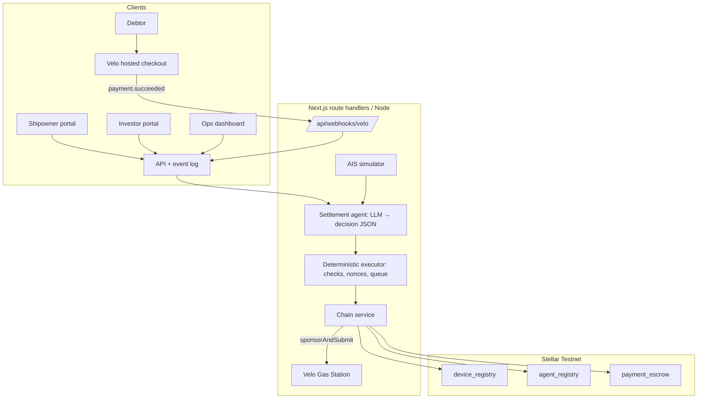

# Product Requirements Document: VisMin Inter-Island Freight Factoring Protocol

> **Codename:** NoirxVelo Freight Factoring (Bunkr VisMin)
> **Tracking ID:** `NV-M0-01`
> **Network:** Stellar Testnet (Noir Soroban contracts) + Velo
> **Version:** 1.1 (draft, kickoff revision)

---

## Document Metadata

| Field | Value |
|---|---|
| **Product** | VisMin Inter-Island Freight Factoring Protocol (`noirxvelo`) |
| **Status** | `Draft: in review`. It becomes `Approved` only after the Nov 5 spikes in §16 pass. |
| **Owner (DRI)** | `@helenaherrero515` |
| **Milestone** | `M0: Hackathon demo`. Build window is Nov 5 to 8, 2026. **Submissions close Sun Nov 8, 8:00 AM (Manila).** |
| **Contracts (Noir Testnet)** | `device_registry` `CB4DPMGOA374JIB2ZVD4AHW5GJKQUYNOFGRYNOJ75EFH2KCJSMHOWIRA`<br>`agent_registry` `CBTDMJVCFQDIVWZBKAKZ2FQ3UEJNAAUFYCTJ3E4ON2MYXPLPSIXQ25JZ`<br>`payment_escrow` `CA5S4S7QGHJHJWVJBYL3CXZXZTNGKXMNZVDAEQNN7NUXFP4D7BYK7HIX` |
| **SDKs** | `@carts1024/velo-sdk@0.1.0-alpha.4`, `@stellar/stellar-sdk`, and optionally `@noirx402/agent-sdk` (pin exact versions on Nov 5) |
| **Audience** | Judges, the build team, and shipping-operator and investor reviewers |
| **Last updated** | 2026-11-05 |

### What changed from v1.0

| Area | v1.0 | v1.1 | Why |
|---|---|---|---|
| Contract methods | Invented `is_authorized`, `get_allowance`, `create_invoice_escrow`, `settle_invoice`, `update_telemetry_status` | Uses the actual interface: `fund_escrow`, `authorize`, `claim`, `defund_escrow`, `sweep_on_revoke`, `register_agent`, `revoke_agent`, `check_payment` | The deployed contracts don't have the v1.0 methods. Code written against them fails on day 1. |
| Settlement model | A single `settle()` call splits funds | The settlement agent makes several capped `authorize` payouts, and each payee then calls `claim` | That is how `payment_escrow` actually moves money. |
| Delivery proof | Written to `device_registry` as `DELIVERED` | Signed attestation kept off-chain, with its hash logged next to the `authorize` tx | The registry stores device identity, not voyage status. |
| Fail-closed | Contract locks into `dispute_pending` with multi-sig review | Agent policy is revoked and funds stay with the escrow owner (treasury). Disputes are resolved off-chain. | That state doesn't exist on-chain. |
| Demo money | ₱1,000,000 in "USDC/PHPT" | Testnet XLM at a fixed **demo rate**, shown in PHP and clearly labeled | Testnet accounts can't hold ₱1M of real stablecoin. The escrow token is fixed per device. |
| Yield math | "3% flat ≈ 18.25% APY" | 3% of face value is about 3.53% on principal over 60 days, about 21.5% simple annualized | v1.0 annualized the yield on face value, not on capital deployed. |
| Velo calls | `anchor: "pdax"`, `velo.gas.sponsor()` only, `verifyWebhookSignature` | Only calls documented by other teams; everything else is marked **[confirm]** | We avoid building on SDK options that may not exist. |
| Status / sign-off | "Approved" with every box ticked on kickoff day | Draft. Sign-off happens after the spikes. | Approval should mean the design has been checked against reality. |
| Seed data | Real companies (San Miguel, Nestlé, 2GO, etc.) as demo customers | Fictional shippers and vessels | Avoids implying partnerships and keeps the pitch clean. |
| Added | — | Hackathon requirement map, agent decision schema, nonce scheme, demo script, schedule, cut order, compliance note | Needed to build and judge the project. |

---

## 1. Summary

### 1.1 One-sentence pitch
Philippine inter-island shipping lines get **85% of a freight invoice the day they sail**. An AI settlement agent, with spending limits enforced on-chain, releases the advance once the e-Waybill checks out. When the cargo owner pays through Velo, the same agent repays investors and returns the reserve to the shipowner.

### 1.2 The problem in one paragraph
Big cargo owners pay freight on Net-60 to Net-90 terms. Shipping lines pay for bunker fuel, port dues and crew **before** sailing. That gap pushes small operators toward slow bank factoring or expensive informal loans. Lenders hesitate for their own reasons: paper waybills can be pledged twice, and nobody can easily confirm that the cargo arrived.

### 1.3 Why this design
- **Bounded agent authority.** The agent can only move money through `payment_escrow.authorize`. `agent_registry.check_payment` rejects any single payment above the cap, after expiry, or in the wrong asset. A compromised agent key is limited to capped payments from one invoice's escrow.
- **Invoice = device.** Each e-Waybill's hash is registered in `device_registry` as the device that owns an escrow balance. That gives every invoice its own on-chain ledger, and a duplicate registration can be rejected (spike S3).
- **Cheap, fast settlement.** Stellar's low fees and fast finality make it practical to settle a single container shipment.
- **Payer stays in Web2.** The cargo owner pays through a hosted Velo checkout link. Velo Gas Station sponsors contract-call fees, so shipowners never handle XLM.

---

## 2. Problem & Pain Points

### 2.1 Context
The VisMin routes (Manila ↔ Cebu ↔ Cagayan de Oro ↔ Davao) carry much of the country's domestic cargo by sea. **[needs source: cite a PPA/MARINA/PSA figure before using any % in the pitch]**

Operators carry three costs that must be paid up front:
1. **Bunker fuel.** It is the largest voyage expense, and suppliers usually want cash before delivery or very short terms.
2. **Port and terminal charges.** Dues, berthage, pilotage and arrastre are paid before departure clearance.
3. **Crew and maintenance.** Payroll and repairs need steady cash.

### 2.2 Pain points
1. **Cash locked in receivables** for 60 to 90 days, which means delayed sailings and costly informal credit.
2. **Bank factoring is slow and hard to get** for small forwarders: long approvals, collateral requirements and minimum ticket sizes. **[needs source for any specific number of weeks or ₱ minimum]**
3. **Double-pledging risk.** The same waybill can be financed twice when it lives on paper.
4. **No delivery visibility for outside capital.** Investors can't check whether cargo arrived.

---

## 3. Goals & Success Criteria

### 3.1 Hackathon goals (Nov 5 to 8)
- [ ] **G1: Contracts.** The full lifecycle runs on Testnet: `register` → `register_agent` → `fund_escrow` → `authorize` → `claim` → `revoke_agent` → `sweep_on_revoke`.
- [ ] **G2: Velo checkout and webhook.** The debtor pays through a Velo checkout session, and a verified, de-duplicated webhook triggers settlement.
- [ ] **G3: Gas Station.** Contract calls are fee-sponsored, with a working fallback if sponsorship is refused.
- [ ] **G4: Agent decides.** The settlement agent issues `ADVANCE`, `SETTLE`, `HOLD` and `DEFAULT` decisions with reasons, and a deterministic executor turns each decision into contract calls.
- [ ] **G5: Demo.** A ~90-second live loop with explorer links for every step, including **one on-chain rejection of an over-cap payment**.

### 3.2 KPIs

| Metric | Target | How we measure |
|---|---|---|
| Advance latency (decision → `authorize` confirmed) | ≤ 10 s on Testnet | Timestamps in the decision log |
| Escrow conservation | Exactly 0 base units left over | After settlement, `balance_of(invoice_device) == 0` and Σ authorized == Σ funded |
| Webhook verification | All valid deliveries accepted; all forged, stale or duplicate ones rejected | Unit tests with fixture payloads |
| Agent policy | 0 over-cap or expired payments succeed | Negative test: an over-cap `authorize` reverts on-chain |
| Idempotency | A replayed webhook or retried job never pays twice | Replay test against the event log |
| Berthing detection (simulated) | 100% on the 3 scripted routes, 0 false positives on the "anchored offshore" case | Simulation tests |

### 3.3 After the hackathon
Live AIS feeds, a PHP stablecoin and off-ramp partner, a multi-investor pool contract, debtor credit scoring from voyage history, and risk-based pricing.

---

## 4. Non-Goals
- **No mainnet and no real money.** Testnet only, with demo amounts.
- **No custody of fiat.** Bank rails and PDAX appear only as roadmap items or labeled mockups.
- **No ML underwriting.** Eligibility uses deterministic rules (§8.3).
- **No pool contract.** In the MVP each invoice has one LP. Pooling happens off-chain or comes later.
- **No physical inspection.** Delivery evidence is simulated AIS plus a terminal discharge event.

**Scope freeze rule:** once the full loop (Tokenize → Advance → Berth → Pay → Settle → Claim) has run cleanly three times on Testnet with recorded tx hashes, freeze the core and polish only.

---

## 5. Personas

| Persona | Need | What they get | Screen |
|---|---|---|---|
| **Shipowner / forwarder CFO** (small inter-island line) | Cash for fuel and port fees now | 85% advance at departure and the reserve back at settlement, without holding XLM | Shipowner portal |
| **Liquidity provider** | Short-tenor, real-economy yield | Principal plus a fixed yield (3% of face in the demo), paid automatically | Investor portal |
| **Cargo owner (debtor) treasurer** | Pay the invoice without touching crypto | A normal hosted checkout link | Velo checkout |
| **Settlement agent** | Clear inputs, bounded authority | Decides advance and settlement within on-chain caps | Ops / agent log |
| **Protocol ops** | Handle exceptions | Hold queue, manual override, revoke and sweep | Ops dashboard |

---

## 6. Principles & Invariants

1. **Least privilege.** The agent key can only call `authorize`, and only within the `agent_registry` policy for that invoice device (cap, asset, expiry). The treasury (escrow owner) key is never given to the LLM.
2. **The LLM proposes and the executor acts.** The model returns a schema-validated decision. Deterministic code checks the preconditions in §8.3, builds the transactions and submits them. If any check fails, nothing is sent.
3. **Integer accounting.** All amounts are `i128` stroops (1 XLM = 10⁷). Rounding rule: yield and fee round **down**, and the shipowner rebate takes the remainder, so the parts always add up to the face value exactly.
4. **Two separate gates:**
   - **Advance gate:** waybill hash newly registered, debtor known, vessel shown underway from the origin port.
   - **Settlement gate:** verified Velo `payment.succeeded` for this invoice **and** a berthing attestation at the destination.
5. **Fail closed.** On any anomaly (AIS dark for more than 12 h, route deviation, invalid webhook, amount mismatch) the agent returns `HOLD`. Ops can `revoke_agent` so no further `authorize` succeeds. Funds stay in escrow under treasury control (`defund_escrow` / `sweep_on_revoke`).
6. **Exactly-once payments.** Every payout uses a deterministic nonce, and webhook handling is idempotent (§10.4).
7. **Gasless for users.** All user and agent transactions go through Velo Gas Station when it accepts them, and a relayer account covers fees when it doesn't.

---

## 7. Scope

### 7.1 P0 (must ship)
- **P0-1 Chain service.** Generated TS bindings (`stellar contract bindings typescript`) or `@noirx402/agent-sdk`, wrapped in one module: `registerDevice`, `registerAgent`, `fundEscrow`, `authorize`, `claim`, `balanceOf`, `pendingBalance`, `getPolicy`, `revokeAgent`, `sweepOnRevoke`, `defundEscrow`.
- **P0-2 Provisioning script.** Creates the Testnet accounts (treasury, shipowner, LP, debtor, settlement agent, relayer) with Friendbot and prints the explorer links.
- **P0-3 Tokenize.** The shipowner enters waybill details. The backend computes `invoice_hash = sha256(canonical_waybill_json)`, then calls `device_registry.register` (treasury as owner) and `agent_registry.register_agent` (cap, asset, expiry).
- **P0-4 Advance.** The LP funds the escrow (`fund_escrow`). The agent decides `ADVANCE`, the executor calls `authorize` to the shipowner, and the shipowner calls `claim`.
- **P0-5 Voyage simulator and berthing check** (§8.2).
- **P0-6 Debtor checkout.** `velo.checkout.sessions.create`, a verified webhook, then the treasury calls `fund_escrow` for the face amount.
- **P0-7 Settlement.** The agent decides `SETTLE`, and the executor makes three sequential `authorize` calls (LP, shipowner rebate, treasury fee). Payees `claim`.
- **P0-8 Guardrail demo.** The agent tries to pay the full face value to one payee. `check_payment` rejects it on-chain, and we show the failed tx.
- **P0-9 Dashboard.** Status badges, a route map, the decision log with reasons, and an explorer link on every step.

### 7.2 P1 (stretch)
- `DEFAULT` path: no payment by the due date + grace, so `revoke_agent` and `sweep_on_revoke` run, and an ops case opens.
- Multiple routes (Manila→Cebu, Cebu→CDO, Manila→Davao) with a weather-delay scenario.
- An LLM-parsed waybill PDF/photo that pre-fills the form (the parse result still goes through schema checks).
- Risk/yield preview slider (UI only).

### 7.3 Later
Pool contract and secondary market, ERP connectors, live AIS subscriptions, PHP stablecoin/off-ramp, legal assignment-of-receivables workflow.

### 7.4 Cut order if behind
1. Multi-route → 2. LLM waybill parsing → 3. `DEFAULT` path → 4. map animation (use a progress bar instead). **Never cut:** tokenize → advance → pay → settle → claim → over-cap rejection.

---

## 8. Settlement Agent

### 8.1 State machine

```mermaid
stateDiagram-v2
    [*] --> TOKENIZED: register + register_agent
    TOKENIZED --> FUNDED: LP fund_escrow
    FUNDED --> ADVANCED: agent ADVANCE → authorize(shipowner)
    ADVANCED --> IN_TRANSIT: AIS underway
    IN_TRANSIT --> BERTHED: geofence + SOG rule met
    IN_TRANSIT --> HOLD: AIS dark > 12h / deviation
    BERTHED --> PAID: verified Velo webhook → treasury fund_escrow
    PAID --> SETTLED: agent SETTLE → 3× authorize
    SETTLED --> CLOSED: payees claim; balance_of == 0
    BERTHED --> DEFAULT: due date + grace passed
    DEFAULT --> CLOSED: revoke_agent → sweep_on_revoke
    HOLD --> IN_TRANSIT: ops clears
```

### 8.2 Telemetry and berthing rule (simulated)
- **Feed:** a local simulator replays GeoJSON tracks with no external API, so the demo always works. Ticks come every 2 s in the demo and every 15 min in production.
- **Origin:** Manila South Harbor (14.580° N, 120.965° E). **Destination geofence:** Port of Cebu, centred at 10.3015° N, 123.9080° E with an 800 m radius. **[confirm the coordinates on a map before the demo]**
- **Berthed** = inside the geofence **and** SOG ≤ 0.5 kn for 3 consecutive ticks. A vessel anchored outside the geofence must **not** count (this is a test case).
- **Attestation:** the agent signs `{invoiceId, mmsi, port, berthTimestamp, lat, lng, sog}`. The record and its hash go in the event log, and the hash is shown next to the settlement txs. Nothing is written to `device_registry`.
- **Honesty note for the pitch:** AIS is self-reported and can be spoofed. Settlement also requires the debtor to pay, and in production we would add terminal discharge data.

### 8.3 Decision contract
The model (any tool-calling LLM) receives a structured context and must return exactly this:

```json
{
  "$schema": "http://json-schema.org/draft-07/schema#",
  "title": "AgentDecision",
  "type": "object",
  "required": ["invoiceId", "decision", "reason", "payouts"],
  "additionalProperties": false,
  "properties": {
    "invoiceId": { "type": "string", "pattern": "^INV-[0-9]{4}-[0-9]{3}$" },
    "decision": { "enum": ["ADVANCE", "SETTLE", "HOLD", "DEFAULT"] },
    "reason": { "type": "string", "maxLength": 280 },
    "payouts": {
      "type": "array",
      "items": {
        "type": "object",
        "required": ["role", "amountStroops"],
        "additionalProperties": false,
        "properties": {
          "role": { "enum": ["SHIPOWNER", "LP", "TREASURY"] },
          "amountStroops": { "type": "string", "pattern": "^[0-9]+$" }
        }
      }
    }
  }
}
```

The model returns **roles, not addresses**. The executor maps each role to the address stored for the invoice, so the LLM can never send money to an arbitrary wallet. Before submitting, the executor checks:

| Decision | Preconditions (all checked in code) | Allowed payouts |
|---|---|---|
| `ADVANCE` | State `FUNDED`, `balance_of ≥ advance`, AIS underway, waybill hash registered by us | `SHIPOWNER = α·V` |
| `SETTLE` | State `PAID`, webhook verified, amount == V, berthing attestation present | `LP = α·V + y·V`, `SHIPOWNER = rebate`, `TREASURY = f·V`, summing to exactly V |
| `HOLD` | Any precondition fails or an anomaly is flagged | none |
| `DEFAULT` | Due date + grace passed, no payment | none (ops runs revoke and sweep) |

If the model's payouts differ from the amounts computed in code, the executor **rejects the decision and logs it**. The model explains the decision, and the numbers come from code.

### 8.4 Degradation
- **AIS gap:** `HOLD` with reason `telemetry_lag`. The invoice is never forfeited automatically.
- **Webhook missing:** poll the payment status (`velo.paymentIntents.retrieve` **[confirm]**), and offer a "re-poll" button in the ops panel.
- **Gas Station refusal** (e.g., `contract_not_whitelisted` or a daily cap): the relayer account pays the fee in testnet XLM.
- **LLM down or invalid output:** the rules engine makes the same decision deterministically and the log is marked `fallback`.

---

## 9. Security & Data

### 9.1 Data classification

| Data | Where it lives | Public? |
|---|---|---|
| Invoice hash, amounts, payout txs | On-chain (escrow events) | Yes |
| Vessel MMSI/IMO, positions | Event log; AIS is public by nature | Yes |
| Cargo SKU / pricing, debtor tax ID | Off-chain DB; only a salted hash is used anywhere public | **No** |
| Agent, treasury and custodial wallet secrets | Server env / encrypted at rest | **Never** |
| Velo API key and webhook secret | Server env only | **Never** |

### 9.2 Threats

| Threat | Mitigation |
|---|---|
| **T-1 AIS spoofing** to fake arrival | Settlement also needs the debtor's payment. Use the geofence + SOG + dwell rule. In production, cross-check terminal data. State this limit openly. |
| **T-2 Double-factoring** | Register the waybill hash in `device_registry` and confirm that a duplicate is rejected (S3). Also enforce a unique hash in our DB. Cross-platform protection only works if other lenders check the same registry; say so. |
| **T-3 Agent key compromise** | Per-payment cap and expiry in `agent_registry`; payees fixed by role in code; one invoice per device keeps the blast radius to one escrow; ops can `revoke_agent` at once. **Note:** the cap applies per payment, not to a running total, so an attacker could make repeated capped payments until the escrow is empty. The off-chain daily limit and alerts cover that. |
| **T-4 Forged or replayed webhook** | Verify the signature over the raw body, enforce a 300 s timestamp window, de-duplicate by delivery ID, and check that the amount and invoice ID match the open session. |
| **T-5 Double payout from retries** | Deterministic nonces (§10.4) and a single in-flight payment per agent. |
| **T-6 Debtor default** | The LP takes the loss in the MVP and sees it disclosed in the investor UI. Later: a first-loss reserve and legal assignment of the receivable. |

### 9.3 Compliance note (not legal advice)
In the Philippines, factoring as a business is generally a regulated financing activity, and selling invoice-backed tokens to investors may be treated as a securities offering. Both fall under the SEC. The pitch should present this as a Testnet prototype and list "regulatory pathway (SEC financing company licence / sandbox)" in the roadmap.

---

## 10. Contracts & Integration

### 10.1 Contract interface we rely on
These come from other teams reading the deployed Rust source. **Confirm them against the source and the generated bindings on Nov 5 (S1).**

| Contract | Call | Notes |
|---|---|---|
| `device_registry` | `register(owner_wallet, device_hash, agent)` | Owner = treasury. `device_hash = invoice_hash`. Exact args **[confirm]**. |
| `agent_registry` | `register_agent(owner_wallet, device_hash, agent, max_amount, asset, expires_at)` | `max_amount` caps **each** payment; `expires_at` is compared to the ledger time (a payment exactly at expiry is still valid). |
| | `check_payment(device_hash, agent, asset, amount)` | Called inside `authorize`; rejects over-cap, expired or wrong-asset payments. |
| | `revoke_agent(...)` | Stops future `authorize` calls. |
| `payment_escrow` | `fund_escrow(token, wallet, device_hash, amount)` | `wallet.require_auth()`. **Any wallet may fund any device. The token is fixed per device at first funding.** |
| | `authorize(agent, device_hash, merchant, asset, amount: i128, nonce: u64)` | `agent.require_auth()` + `check_payment`. Creates a pending balance for `merchant`. |
| | `claim(token, merchant)` | Signed by the merchant; pays out everything pending for that merchant across all devices. |
| | `defund_escrow(...)`, `sweep_on_revoke(token, device_hash, agent)` | Owner only. Order: `revoke_agent` → `sweep_on_revoke` → (optional) device revoke. Never revoke the device while its balance is above 0. |
| | `balance_of`, `pending_balance` (+ `get_policy` on the registry) | Read calls for the dashboard and the invariant checks. |
| Events | `fund`, `authorize`, `claim`, `defund`, `sweep` | Drive the dashboard from these. |

### 10.2 Mapping factoring onto the escrow

| Factoring concept | On-chain primitive |
|---|---|
| Invoice | Device in `device_registry` (`device_hash = sha256(waybill)`) owned by the treasury |
| Agent's mandate for this invoice | `agent_registry` policy: `max_amount = α·V + y·V` (largest single payout), `asset = XLM SAC`, `expires_at = due date + grace` |
| LP advance | LP `fund_escrow(token, lp_wallet, invoice_hash, α·V)` → agent `authorize(…, shipowner, α·V, n)` → shipowner `claim` |
| Debtor payment | Velo checkout → treasury receives it → treasury `fund_escrow(token, treasury, invoice_hash, V)` |
| Settlement | Agent `authorize` ×3 with nonces n+1, n+2, n+3 → LP, shipowner, treasury each `claim` |
| Default / exit | `revoke_agent` → treasury `sweep_on_revoke` |
| Over-cap guardrail demo | Agent `authorize(…, shipowner, V, n+k)` with `V > max_amount` → reverts in `check_payment` |

> Because `claim` pays out across all devices, use **separate demo wallets per role** so each claim is easy to read on the explorer.

### 10.3 Demo currency (decision D-1)
- **Default:** settle in **testnet XLM** through the native asset contract (`Asset.native().contractId(Networks.TESTNET)`). This is known to work with `payment_escrow`.
- Show PHP in the UI at a **fixed demo rate, 1 XLM = ₱1,000**, with a visible "demo rate" label. A ₱1,000,000 invoice is therefore 1,000 XLM, which a Friendbot-funded account can hold.
- *Alternative:* issue a test asset (`tPHP`) from the treasury and use its SAC. That allows 1:1 peso amounts but adds trustline setup. Pick one on Nov 5 and don't switch.

### 10.4 Nonces & idempotency
- One nonce sequence per (invoice device, agent). Nonces must be **strictly increasing** (gaps are allowed). If a higher nonce lands first, every lower one fails, so **only one `authorize` per agent can be in flight**. Use a per-agent queue or lock.
- Store `(invoice_id, step) → nonce` before submitting. On retry, reuse the same nonce. If the tx already landed, the retry fails harmlessly.
- Webhooks: de-duplicate by the Velo delivery/event ID **before** any side effect.

### 10.5 Velo integration
Use only calls we can confirm in the SDK README or types on Nov 5. Calls other teams have used are listed first.

```typescript
import { Velo } from "@carts1024/velo-sdk";

export const velo = new Velo({ apiKey: process.env.VELO_API_KEY!, environment: "testnet" }); // [confirm option names]

// Debtor checkout. The amount is in the CHECKOUT asset, not PHP.
export async function createDebtorCheckout(inv: Invoice) {
  return velo.checkout.sessions.create({
    amount: toAssetAmount(inv.faceValueStroops), // e.g. "1000.0000000" XLM for ₱1,000,000 at the demo rate
    asset: "XLM",                                // [confirm supported assets]
    description: `Freight invoice ${inv.id} (Manila → Cebu)`,
    successUrl: `${process.env.APP_URL}/pay/success?invoiceId=${inv.id}`,
    cancelUrl: `${process.env.APP_URL}/pay/cancel?invoiceId=${inv.id}`,
  });
  // v1.0's `anchor: "pdax"` is removed: it isn't a documented option.
}

// Fee sponsorship: submit, then wait. Only a final "succeeded" counts.
export async function submitSponsored(signedXdr: string, opId: string) {
  const r = await velo.gas.sponsorAndSubmit(signedXdr, { idempotencyKey: `vismin:${opId}` });
  return velo.gas.waitForResult(r); // [confirm signature]
}

// Webhook: verify the RAW body; header names are [confirm] (seen: x-velo-signature, x-velo-delivery)
export async function handleVeloWebhook(req: Request) {
  const raw = await req.text();
  const event = await Velo.webhooks.verify(raw, req.headers.get("x-velo-signature")!, process.env.VELO_WEBHOOK_SECRET!); // [confirm]
  // de-dupe on delivery id, match session → invoice, check amount, then enqueue treasury fund_escrow
  return event;
}
```

**Open (S4):** which address and asset receive a Velo checkout payment (`receiverAddress`)? The plan is that the payment lands in the treasury and the treasury then calls `fund_escrow`. If Velo can pay directly to a contract call, we can drop that hop later.

### 10.6 Math

Let V = face value, α = 0.85 (advance), y = 0.03 of V (LP yield), f = 0.005 of V (protocol fee).

- Advance = ⌊α·V⌋
- LP repayment = Advance + ⌊y·V⌋
- Fee = ⌊f·V⌋
- Shipowner rebate = V − LP repayment − Fee *(absorbs rounding)*

**Yield, stated correctly:** the LP deploys α·V and earns y·V, so the return on capital is y/α = 3.53% over 60 days, about **21.5% simple annualized** (3.53% × 365/60). Quote that figure, not 18.25%.

| Step | From → To | Demo ₱ | Testnet XLM (₱1,000 = 1 XLM) |
|---|---|---:|---:|
| LP funds the escrow | LP → escrow | 850,000 | 850 |
| Advance | escrow → shipowner (`authorize` + `claim`) | 850,000 | 850 |
| Debtor pays | debtor → Velo → treasury → escrow | 1,000,000 | 1,000 |
| LP repayment | escrow → LP | 880,000 | 880 |
| Rebate | escrow → shipowner | 115,000 | 115 |
| Fee | escrow → treasury | 5,000 | 5 |
| **Check** | `balance_of(invoice)` after settlement | **0** | **0** |

Agent cap for this invoice: `max_amount = 880 XLM`. The guardrail demo tries 1,000 XLM and is rejected.

---

## 11. Hackathon Requirement Map

| Requirement | Where we meet it |
|---|---|
| Agent decides / makes the payment | Settlement agent issues `ADVANCE`/`SETTLE` and signs `authorize` itself (§8) |
| Built with Velo | Checkout sessions, verified webhooks, Gas Station sponsorship (§10.5) |
| Uses `device_registry` | Each invoice is a registered device (§10.2) |
| Uses `agent_registry` | Per-invoice cap, asset and expiry; over-cap rejection shown live |
| Uses `payment_escrow` | `fund_escrow`, `authorize`, `claim`, `sweep_on_revoke` |
| Latest Testnet contracts | Addresses in the metadata; re-confirm against the hackathon form |

---

## 12. Functional Requirements

| ID | Area | Requirement | P | Acceptance check |
|---|---|---|:-:|---|
| FR-01 | Chain | Chain service wraps every call in §10.1 behind one module | P0 | Script runs the full lifecycle on Testnet and prints tx links |
| FR-02 | Tokenize | Shipowner submits a waybill; the system registers the device and agent policy | P0 | Device and policy are readable on-chain; re-submitting the same waybill fails |
| FR-03 | Fund | LP funds the advance with one click | P0 | `balance_of(invoice) == α·V` |
| FR-04 | Advance | Agent advances to the shipowner after the advance gate | P0 | `authorize` tx + `claim` tx; shipowner balance increases |
| FR-05 | Telemetry | Simulator plus berthing rule | P0 | Berth detected on 3 routes; the offshore-anchor case is not |
| FR-06 | Checkout | Debtor checkout session created for an invoice | P0 | The returned `checkoutUrl` opens and payment completes on Testnet |
| FR-07 | Webhook | Verified, de-duplicated webhook moves the invoice to `PAID` | P0 | Forged, stale and duplicate deliveries are rejected in tests |
| FR-08 | Settle | Agent settles with 3 capped payouts summing to V | P0 | Escrow balance is 0; three `authorize` events; claims succeed |
| FR-09 | Guardrail | Over-cap payment is rejected on-chain | P0 | Failed tx hash shown in the UI |
| FR-10 | Gas | Calls are sponsored by Gas Station, with relayer fallback | P0 | Shipowner and LP accounts spend 0 XLM on fees |
| FR-11 | Dashboard | Badges, decision log with reasons, explorer links | P0 | Every step in the demo has a clickable tx |
| FR-12 | Default | Revoke and sweep after the due date | P1 | `sweep` event; treasury balance restored |
| FR-13 | Routes | Route switcher with a delay scenario | P1 | — |

---

## 13. UX

- **Badges:** `TOKENIZED → FUNDED → ADVANCED → IN_TRANSIT → BERTHED → PAID → SETTLED`, plus `HOLD` and `DEFAULT` in amber/red.
- **Role switcher** in the header: Shipowner / Investor / Debtor / Ops. Each view uses its own demo wallet.
- **Decision cards:** decision, one-line reason, computed amounts, nonce, tx link. Clicking a card opens the raw decision JSON and the attestation.
- **Demo-rate label** wherever an amount appears in PHP.
- **Seed data uses fictional names:** e.g., *MV VisMin Pioneer* (Manila→Cebu, ₱1,000,000, Net-60) shipping for *"Isla Beverages Corp."*; *MV Mindanao Express* (Cebu→CDO, ₱750,000, Net-45); *MV Archipelago Star* (Manila→Davao, ₱1,500,000, Net-90).
- **No blank states:** every screen works from the seed data without typing.

### Demo script (~90 s)
1. Shipowner tokenizes the invoice (device and policy tx links appear).
2. Investor funds ₱850k; the agent explains its `ADVANCE` decision; the advance tx and the claim appear.
3. Ship sails on the map; it berths at Cebu, and the attestation card appears.
4. Debtor pays through the Velo checkout; the webhook is verified and the escrow is funded.
5. The agent tries a single ₱1M payout to the shipowner and **the chain rejects it**.
6. The agent explains its `SETTLE` decision; three payouts and claims follow, and the escrow balance reads **0**.

---

## 14. Architecture & Stack



| Layer | Choice |
|---|---|
| App | Next.js (App Router) + TypeScript, Tailwind |
| DB / event log | SQLite for the demo (Postgres if deployed) |
| Chain | `@stellar/stellar-sdk` + generated bindings, Soroban RPC `https://soroban-testnet.stellar.org` |
| Payments | `@carts1024/velo-sdk` |
| Agent | Any tool-calling LLM behind the decision schema, with a rules-engine fallback |
| Map | Leaflet + OpenStreetMap tiles, or a static SVG if offline |

---

## 15. Testing

1. **Unit:** factoring math with property tests (parts always sum to V, for random V); decision validator; webhook verify (valid, forged, stale, duplicate); berthing rule (inside/outside, dwell).
2. **Contract integration on Testnet:** lifecycle script (FR-01); over-cap revert; nonce reuse fails; `claim` pays the expected pending amount.
3. **End to end:** full demo loop three times in a row with recorded hashes (scope-freeze trigger).
4. **Demo insurance:** pre-funded accounts, a recorded backup video, and a "simulate webhook" button in ops.

---

## 16. Spikes to run on Nov 5 (before building on assumptions)

| ID | Question | Fallback |
|---|---|---|
| S1 | Exact signatures of `register`, `register_agent`, `revoke_agent`, `defund_escrow`, `sweep_on_revoke` in the deployed source / bindings | Adjust the chain service only; nothing else should change |
| S2 | Can the LP (a wallet other than the device owner) fund the invoice device, and does `sweep_on_revoke` then return those funds to the **owner**? | Have the LP pay the treasury, which funds the escrow |
| S3 | Does `device_registry.register` reject an already-registered hash? | Enforce uniqueness in the DB and describe on-chain uniqueness as a roadmap item |
| S4 | Where do Velo checkout payments settle (address, asset)? Which assets does checkout support? | Treasury receives, then funds the escrow |
| S5 | Is `payment_escrow` on Gas Station's allowed-contract list? What are the daily limits? | Relayer pays fees |
| S6 | Velo webhook header names, the verify helper and the event types in alpha.4 | Verify HMAC manually per Velo docs |
| S7 | Is `@noirx402/agent-sdk` compatible with the current contracts? Is it faster than generated bindings? | Generated bindings |

Record the results in `docs/spikes.md`, then update §10 and change the status to Approved.

---

## 17. Schedule (Manila time)

| Day | Goal | Exit criterion |
|---|---|---|
| **Thu Nov 5** | Spikes S1 to S7, provisioning script, lifecycle script | A real `authorize` and `claim` land on Testnet |
| **Fri Nov 6** | Tokenize → advance → checkout → webhook → settle, end to end (ugly UI is fine) | Full loop once with hashes by midnight |
| **Sat Nov 7** | Over-cap demo, dashboard polish, map, deploy, backup video, README + diagram | Loop runs 3× clean → **code freeze Saturday night** |
| **Sun Nov 8** | Final checks, **submit before 8:00 AM** | Submitted |

---

## 18. Team

| Area | Lead | Backup |
|---|---|---|
| Product, pitch, frontend | `@helenaherrero515` | — |
| Chain service & provisioning | _TBD_ | — |
| Velo checkout, webhooks, Gas Station | _TBD_ | — |
| Agent, executor, simulator | _TBD_ | — |

*(Fill in names. With 2 people, combine chain + Velo, and agent + frontend.)*

---

## 19. Risks

| ID | Risk | Impact | Mitigation | Owner |
|---|---|:-:|---|---|
| R-01 | Contract interface differs from §10.1 | High | S1 on day 1; all calls behind one wrapper | Chain |
| R-02 | Velo checkout can't feed the escrow directly | Med | Treasury hop (S4) | Velo |
| R-03 | Gas Station refuses escrow calls | Med | Relayer account (S5) | Velo |
| R-04 | Testnet / RPC slow during the pitch | High | Retries with backoff, cached state, backup video | Backend |
| R-05 | Nonce collision from concurrent payouts | Med | Per-agent queue, one tx in flight | Agent |
| R-06 | Judges lost in maritime and finance jargon | High | Lead with "₱850k for fuel the day they sail" and keep the ship moving on the map | Product |
| R-07 | Regulatory questions in Q&A | Med | §9.3 talking points; present it as a Testnet prototype | Product |

---

## 20. Submission Checklist
- [ ] Uses Velo SDK, `device_registry`, `agent_registry`, `payment_escrow` on the latest Testnet
- [ ] Public repo with README, architecture diagram, setup steps, `.env.example`
- [ ] `docs/spikes.md` with the S1 to S7 results
- [ ] Explorer links: full happy path **and** the rejected over-cap payment
- [ ] Live demo URL + backup video
- [ ] Pitch deck (problem → solution → live demo → why Stellar/Noir/Velo → market → roadmap)
- [ ] Submitted before **Sun Nov 8, 8:00 AM**

---

## 21. Sign-Off (after spikes)
- [ ] Product & architecture (`@helenaherrero515`)
- [ ] Chain service lead: §10.1 confirmed against the source
- [ ] Velo lead: §10.5 confirmed against the SDK
- [ ] Agent lead: decision schema and executor checks agreed