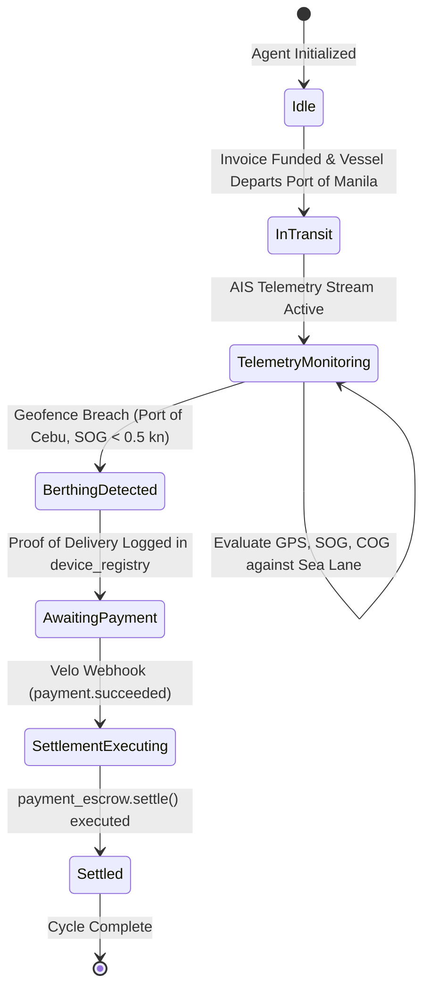
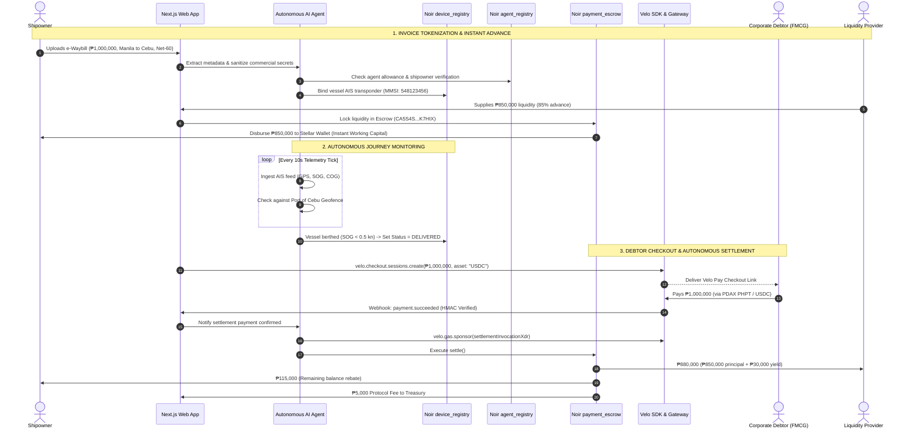
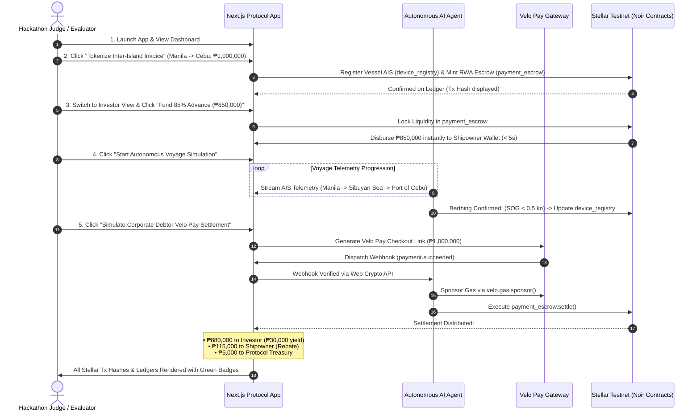
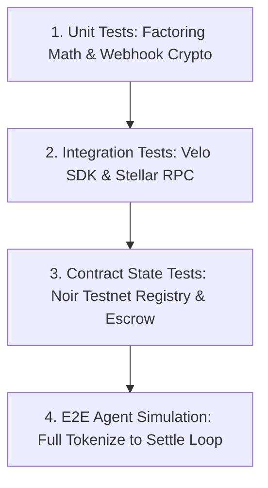

# Product Requirements Document: VisMin Inter-Island Freight Factoring Protocol
> **Protocol Codename:** NoirxVelo Freight Factoring (Bunkr VisMin)  
> **Template Version:** 1.0.0  
> **Source Standard:** Noir x Velo Hackathon Standards / Verma Engineering Standards (`docs/prd.md`, `docs/AGENTS.md`)  
> **Task / Tracking ID:** `NV-M0-01`  
> **Target Network:** Stellar Testnet (Soroban Contracts) & Velo Infrastructure  

---

## Document Metadata

| Field | Value | Description |
|---|---|---|
| **Product / Feature Name** | **VisMin Inter-Island Freight Factoring Protocol** (`noirxvelo`) | Web3 PayFi & RWA freight invoice factoring protocol for Philippine domestic shipping |
| **Status** | `Approved` | Target implementation specification for the Noir x Velo Hackathon |
| **Document Owner** | `@helenaherrero515` | Directly responsible individual (DRI) / Product Lead |
| **Target Milestone** | `M0: Hackathon P0 Winning Demo` | Submission milestone: Sunday, Nov 8, 2026 (Kickoff: Nov 5, 2026) |
| **Assigned Lane** | `Lane A: Full-Stack Protocol (Contracts, Velo SDK, Agent, UI)` | End-to-end hackathon implementation lane |
| **Related Smart Contracts** | • `agent_registry`: `CBTDMJVCFQDIVWZBKAKZ2FQ3UEJNAAUFYCTJ3E4ON2MYXPLPSIXQ25JZ`<br>• `device_registry`: `CB4DPMGOA374JIB2ZVD4AHW5GJKQUYNOFGRYNOJ75EFH2KCJSMHOWIRA`<br>• `payment_escrow`: `CA5S4S7QGHJHJWVJBYL3CXZXZTNGKXMNZVDAEQNN7NUXFP4D7BYK7HIX` | Verified Noir Testnet Soroban contracts on Stellar |
| **Velo Integration** | `@carts1024/velo-sdk@0.1.0-alpha.4` (`https://velo-build.dev`) | Velo Checkout Sessions, Gas Station sponsorship, and Webhook verification |
| **Primary Audience** | Hackathon Judges, Web3 Investors, Domestic Shipping Operators, Security Auditors | Reviewers and ecosystem evaluators |
| **Last Updated** | 2026-11-05 | Hackathon kickoff day |

---

## 1. Executive Summary & Core Mission

### 1.1 One-Sentence Pitch
An autonomous Web3 freight invoice factoring protocol that turns verified Philippine inter-island e-Waybills into tokenized Real World Assets (RWAs), unlocks immediate 80–85% working capital for shipping lines via Stellar Testnet liquidity pools, and automates repayment and yield settlement via an AI Agent monitoring vessel AIS telemetry feeds and Velo Pay checkout rails.

### 1.2 Core Mission & Elevator Pitch
In the Philippine archipelagic supply chain (7,641 islands), domestic shipping lines (e.g., 2GO, Trans-Asia Shipping Lines, FastCat, Lorenzo Shipping) and regional forwarders provide the economic lifeline connecting Luzon, the Visayas, and Mindanao (Manila $\leftrightarrow$ Cebu $\leftrightarrow$ Cagayan de Oro $\leftrightarrow$ Davao). However, shipping operators are crushed by a structural cash-flow mismatch: multi-billion-peso corporate cargo owners (conglomerates and FMCGs like San Miguel, Nestlé, Universal Robina) enforce **60 to 90-day payment terms**, while shipping lines must pay **cash-before-delivery for bunker fuel**, **upfront cash terminal fees to port authorities**, and **daily crew payroll**.

The **VisMin Inter-Island Freight Factoring Protocol** solves this multi-million-peso liquidity bottleneck. Shipping lines upload verified e-Waybills and freight invoices to mint RWA Freight Tokens. Global and domestic liquidity providers fund these invoices upfront (disbursing an **85% advance in seconds** to the operator’s Stellar wallet). An **Autonomous AI Agent** tracks the vessel’s physical voyage using maritime AIS transponder and port telemetry registered in Noir’s `device_registry`, while Noir’s `agent_registry` enforces strictly constrained agent spending allowances. When cargo is delivered and the corporate debtor settles the invoice via a frictionless **Velo Pay checkout link** (supporting PHPT/USDC with PDAX on/off-ramp options), the AI Agent triggers automated settlement through Noir’s `payment_escrow` contract—distributing principal + yield (2%–5%) to investors, releasing the remaining 15% reserve minus fees to the shipowner, and retaining a 0.5% protocol fee.

```
┌────────────────────────────────────────────────────────────────────────────────────────┐
│                                VISMIN FACTORING PROTOCOL                               │
├────────────────────────────────┬───────────────────────────────────────────────────────┤
│ 1. Invoice Tokenization        │ Domestic Shipowner uploads ₱1,000,000 e-Waybill (Net-60)│
│ 2. Upfront Cash Flow (85%)     │ Liquidity pool funds ₱850,000 instantly to shipowner   │
│ 3. Autonomous Monitoring       │ AI Agent monitors AIS telemetry (Manila → Cebu port)  │
│ 4. Velo Pay Checkout           │ Corporate debtor settles ₱1,000,000 via Velo link     │
│ 5. Automated Settlement        │ Escrow splits: ₱880k to LPs (₱30k yield), ₱115k rebate │
└────────────────────────────────┴───────────────────────────────────────────────────────┘
```

### 1.3 The Autonomous Agent & Stellar Advantage
- **Programmatic Trust via Constrained Agents:** Traditional factoring requires manual paper audits, phone confirmations, and days of clerical verification. The Noir `agent_registry` allows an autonomous AI agent to verify delivery telemetry and disburse funds strictly according to cryptographic rules without human delay or custodial risk.
- **Micro-Fee, Sub-Second Settlement on Stellar:** Stellar provides 3- to 5-second ledger finality with near-zero transaction fees ($< \$0.0001$), making high-frequency freight micro-factoring economically viable down to single container shipments.
- **Frictionless Enterprise Payments via Velo:** Corporate FMCG treasurers will not navigate complex Web3 wallets or bridges; `@carts1024/velo-sdk` delivers a hosted Velo Pay checkout experience integrated with Philippine fiat anchors (PDAX PHPT stablecoins) and gas-sponsored transactions (`velo.gas.sponsor`).
- **Cryptographic Physical-World Binding:** By anchoring vessel AIS transponders and container GPS beacons in Noir’s `device_registry`, invoices are irrevocably tied to physical maritime assets, eliminating ghost shipments and invoice duplication fraud.

---

## 2. Problem Statement & User Pain Points

### 2.1 The Problem: The Philippine Domestic Sea-Freight Working Capital Trap
The Philippines is an archipelagic nation where over 85% of domestic trade tonnage is moved by sea. The golden inter-island shipping triangle connects the Port of Manila (North/South Harbor) to the Port of Cebu (Central Visayas) and the Ports of Cagayan de Oro and Davao (Mindanao). 

Large industrial conglomerates and FMCG shippers dictate commercial credit terms. Shipping companies transport millions of pesos worth of cargo under deferred Net-60 to Net-90 day invoicing. However, maritime operations have zero tolerance for payment delays:
1. **Bunker Fuel (40%–55% of Voyage Opex):** Marine Gas Oil (MGO) and Very Low Sulfur Fuel Oil (VLSFO) suppliers (Petron, Shell, Phoenix Petroleum, SeaOil) enforce Cash-Before-Delivery (CBD) or maximum Net-7 terms before a bunker barge connects to the vessel manifold.
2. **Port Terminal Fees (PPA & Private Operators):** The Philippine Ports Authority (PPA) and terminal concessionaires (ICTSI, ATI, Cebu Port Authority) require immediate upfront payment of vessel entrance dues, berthage fees, pilotage, tug assist, and arrastre/stevedoring charges before granting vessel departure clearance.
3. **Crew Wages and Vessel Maintenance:** Daily vessel operations require constant cash liquidity for seafarer payroll (regulated under POEA/DOLE standards), ship provisions, and emergency engine maintenance.

### 2.2 Core Pain Points
1. **Crippling Working Capital Drought:** Shipowners and forwarders operate on razor-thin operating margins with their capital tied up in unpaid receivables, forcing them to delay vessel sailings, cut profitable routes, or take predatory informal loans (5–10% monthly interest).
2. **Traditional Bank Factoring Failure:** Philippine commercial banks (BDO, BPI, Metrobank) take 3 to 6 weeks to approve factoring credit lines, mandate heavy real-estate collateral, and refuse to process invoices under ₱10,000,000 or invoices from SME forwarders.
3. **Invoice Fraud & Double-Financing Risk:** In the domestic paper-heavy logistics sector, unscrupulous operators occasionally pledge the same Bill of Lading (BOL) or e-Waybill across multiple financial institutions, creating high risk that scares away conventional non-bank lenders.
4. **Friction in Cross-Border & Web3 Settlement:** Global DeFi liquidity pools want access to uncorrelated, high-yielding Real World Assets (RWAs), but cannot navigate Philippine logistics paperwork, domestic banking rails, or verify whether cargo actually arrived at the port.

---

## 3. Goals & Success Criteria

### 3.1 Primary Milestone / Hackathon Goals (Nov 5 – Nov 8, 2026)
- [ ] **Goal 1 (Contract Integration):** Successfully connect and execute transactions against the three deployed Noir Testnet contracts:
  - `agent_registry` (`CBTDMJVCFQDIVWZBKAKZ2FQ3UEJNAAUFYCTJ3E4ON2MYXPLPSIXQ25JZ`)
  - `device_registry` (`CB4DPMGOA374JIB2ZVD4AHW5GJKQUYNOFGRYNOJ75EFH2KCJSMHOWIRA`)
  - `payment_escrow` (`CA5S4S7QGHJHJWVJBYL3CXZXZTNGKXMNZVDAEQNN7NUXFP4D7BYK7HIX`)
- [ ] **Goal 2 (Velo SDK Checkout & Webhooks):** Integrate `@carts1024/velo-sdk@0.1.0-alpha.4` to generate working Velo Pay checkout sessions for invoice settlement and handle cryptographic webhook callbacks (`payment.succeeded`, `contract.event`).
- [ ] **Goal 3 (Velo Gas Station Sponsorship):** Implement `velo.gas.sponsor()` to sponsor transaction fees for shipowner invoice registration and agent settlement calls, proving a 100% gasless UX on Stellar Testnet.
- [ ] **Goal 4 (Autonomous AI Agent Engine):** Demonstrate an autonomous off-chain AI agent that evaluates simulated/live AIS marine telemetry, confirms vessel berthing at Port of Cebu, and executes the escrow settlement cycle without human intervention.
- [ ] **Goal 5 (Live End-to-End Demo Loop):** Deliver a polished Next.js application showcasing:
  1. Shipowner e-Waybill tokenization & instant 85% liquidity payout.
  2. Real-time AIS vessel telemetry map and geofence tracking.
  3. Corporate debtor Velo Pay checkout settlement.
  4. Instant programmatic yield disbursement to investor wallets.

### 3.2 Product Goals Beyond Current Milestone (Post-Hackathon)
- Integrate live satellite AIS data feeds (Spire Maritime / AISHub API) covering all major domestic Philippine sealanes.
- Partner with domestic Philippine anchors (e.g., PDAX PHPT stablecoin) for direct automated PHP bank settlement via InstaPay / PESONet.
- Deploy smart contract credit scoring based on historic voyage completion records stored in `device_registry`.
- Enable dynamic risk pricing: automated factoring fee calculation based on vessel class, weather/typhoon risk, and debtor credit rating.

### 3.3 Quantitative Success Metrics & KPIs

| Metric | Target | Measurement Method | Verification Task |
|---|---|---|---|
| **Advance Payout Latency** | $\le 5.0\text{ seconds}$ | Wall-clock time from investor pool funding to shipowner Stellar wallet receipt | Automated E2E test (`test-advance-payout.ts`) |
| **Velo Checkout Generation** | $\le 1.5\text{ seconds}$ | Latency of `velo.checkout.sessions.create()` API call | Integration benchmark (`velo-checkout.test.ts`) |
| **Webhook Signature Verification** | $100\%$ valid passes; $100\%$ forged rejected | Web Crypto API signature test against Velo secret | Security test (`webhook-signature.test.ts`) |
| **Gas Station Sponsorship Rate** | $\ge 99\%$ success | Testnet Soroban transaction fee sponsorship via `velo.gas.sponsor()` | Gas module test (`gas-sponsor.test.ts`) |
| **Autonomous Berthing Detection Accuracy** | $100\%$ on simulated Cebu geofence breach | AI agent state machine evaluation on GPS/AIS coordinates | Agent simulation test (`agent-berthing.test.ts`) |
| **Escrow Fund Accounting Integrity** | $0.00\text{ discrepancy}$ | Strict conservation: $\text{Advance} + \text{Yield} + \text{Rebate} + \text{Fee} \equiv \text{Face Value}$ | Math invariant unit tests (`escrow-math.test.ts`) |
| **Agent Authorization Constraint** | $0\text{ unauthorized calls}$ | Noir `agent_registry` rejects transactions exceeding per-payment caps | Policy test (`agent-limits.test.ts`) |

---

## 4. Non-Goals & Scope Boundaries

### 4.1 Explicit Non-Goals for this Milestone
- **NO Unregulated Fiat Custody:** The protocol will not hold custody of Philippine Pesos directly in commercial bank accounts; all fiat representation is anchored via Stellar USDC or PDAX PHPT stablecoin contracts.
- **NO Complex Underwriting AI:** The MVP agent will not build a full balance-sheet ML risk model; credit scoring is simulated via verified historical invoice data and deterministic rules.
- **NO Physical Cargo Inspection:** Proof of delivery relies on AIS vessel docking telemetry, container GPS beacon pings, and port gate-out events—not manual physical cargo unboxing audits.
- **NO Mainnet Deployment in Hackathon:** Deployment is strictly constrained to Stellar Testnet and Noir Testnet contract addresses provided by the hackathon committee.

### 4.2 Scope Cutoff Trigger
> **Hard Cutoff Rule:** Once the complete 4-step loop (Tokenize $\rightarrow$ Fund Advance $\rightarrow$ Berthing Verification $\rightarrow$ Velo Pay Settlement) runs cleanly three (3) consecutive times on Stellar Testnet with recorded transaction hashes, freeze the core code. Do not add auxiliary features (e.g., multi-currency swaps, secondary debt markets) that risk demo stability during the face-to-face pitch.

---

## 5. Target Personas & Deployment Modes

### 5.1 Persona Matrix

| Persona | Role / Profile | Primary Pain Point | Core Value Delivered | UI View / Touchpoint |
|---|---|---|---|---|
| **Domestic Shipowner / Forwarder** | Operations CFO at regional shipping line (e.g. 5–20 inter-island cargo vessels). | Waits 60–90 days for freight payments while bunker suppliers demand immediate cash before bunkering. | Instant 85% cash advance on verified e-Waybills in seconds; zero bank paperwork; gasless UX. | **Shipowner Portal:** Invoice upload, instant balance tracker, vessel registration. |
| **Web3 Liquidity Provider (LP)** | Global DeFi treasury, crypto fund, or high-yield individual investor. | Low yield on traditional DeFi lending; seeks uncorrelated Real World Asset (RWA) cash flows. | 2%–5% flat yield over 30–60 days (18%–30% annualized APY) backed by verified real-world shipping debt. | **Investor Portal:** Invoice debt pool catalog, risk metrics, one-click funding. |
| **Corporate Debtor (Cargo Owner)** | Treasury Manager at FMCG conglomerate (San Miguel, Nestlé, Del Monte). | Dislikes dealing with crypto, wallets, private keys, or changing accounting software. | Clean, branded Velo Pay checkout link to pay invoices via existing fiat/banking methods (e.g. PDAX rails). | **Velo Checkout Screen:** Familiar payment page, zero crypto friction. |
| **Autonomous AI Agent** | Off-chain software agent operating under delegated Noir authority. | Manual reconciliation between vessel tracking satellites and blockchain escrow contracts is slow and error-prone. | Autonomous 24/7 telemetry monitoring, geofence verification, and automated escrow triggering. | **Agent Dashboard / Logs:** Live telemetry stream, event decisions, proof hashes. |

### 5.2 System Topology & Deployment Modes

```mermaid
graph TD
    subgraph Layer 1: Client & User Applications
        SO[Shipowner Portal: Next.js] -->|Uploads e-Waybill & Invoice| API[Protocol Backend API]
        LP[Investor Portal: Next.js] -->|Supplies USDC/PHPT Liquidity| API
        CD[Corporate Debtor] -->|Receives Velo Checkout Link| VP[Velo Pay Gateway]
    end

    subgraph Layer 2: Off-Chain Autonomous Agent Engine
        AIS[Maritime AIS Telemetry Stream] -->|Vessel GPS / Berthing Data| AGENT[Autonomous AI Agent Engine]
        API -->|Invoice & Device Metadata| AGENT
        VP -->|Webhook: payment.succeeded| WH[Velo Webhook Listener]
        WH -->|Verified Settlement Trigger| AGENT
    end

    subgraph Layer 3: Velo Platform & Operations Layer
        VELO_SDK[@carts1024/velo-sdk] <-->|Gas Station: sponsor| GS[Velo Gas Station API]
        VELO_SDK <-->|Checkout Sessions API| VP
        AGENT -->|Uses SDK for Payouts & Calls| VELO_SDK
    end

    subgraph Layer 4: Noir Testnet Smart Contracts on Stellar
        AGENT -->|Verify Allowed Spending Limits| AR[agent_registry<br/>CBTDMJVCFQDIVWZBKAKZ2FQ3UEJNAAUFYCTJ3E4ON2MYXPLPSIXQ25JZ]
        AGENT -->|Verify Vessel AIS Transponder & Hash| DR[device_registry<br/>CB4DPMGOA374JIB2ZVD4AHW5GJKQUYNOFGRYNOJ75EFH2KCJSMHOWIRA]
        AGENT -->|Trigger Payout & Final Settlement| PE[payment_escrow<br/>CA5S4S7QGHJHJWVJBYL3CXZXZTNGKXMNZVDAEQNN7NUXFP4D7BYK7HIX]
    end

    PE -.->|Instant 85% Advance| SOW[Shipowner Stellar Wallet]
    PE -.->|Principal + 3% Yield| LPW[Investor Stellar Wallet]
    PE -.->|0.5% Protocol Fee| TREASURY[Protocol Treasury Wallet]
```

---

## 6. Product Principles & Engineering Invariants

1. **Constrained Agentic Autonomy (Least Privilege):** The AI Agent never holds full custodial keys to protocol funds. It acts strictly through permissions granted inside Noir's `agent_registry`, with on-chain spending limits and strict destination whitelisting enforced by `payment_escrow`.
2. **Deterministic Cryptographic Accounting:** The math of invoice factoring is deterministic:
   $$\text{Face Value} \equiv \text{Advance (85\%)} + \text{Yield (3\%)} + \text{Shipowner Rebate (11.5\%)} + \text{Protocol Fee (0.5\%)}$$
   Zero rounding leaks or floating-point imprecision are allowed; all calculations use integer stroops / base units.
3. **Physical-World Proof Before Settlement:** The AI Agent is strictly prohibited from executing final escrow yield distribution unless both conditions are met:
   - Proof of physical delivery is validated via `device_registry` (AIS berthing coordinates matched to port geofence).
   - Proof of corporate payment is confirmed via Velo webhook cryptographically verified with the shared secret.
4. **Zero-Gas Friction for Shipowners:** Shipping operators must never be forced to acquire, hold, or manage XLM to pay network gas fees. All Soroban transaction invocations utilize Velo's Gas Station (`velo.gas.sponsor()`).
5. **Fail-Closed Escrow Security:** If any anomaly occurs (e.g., vessel deviates from route, AIS transponder goes dark for $>12$ hours, or webhook signature verification fails), the `payment_escrow` contract locks into a `dispute_pending` state, requiring multi-sig governance review.
6. **Immutable e-Waybill Anchoring:** Every tokenized invoice must have its SHA-256 content hash anchored in the contract at mint time to prevent duplicate factoring across multiple protocols.
7. **Strict Schema & Type Enforcement:** All off-chain agent inputs and outputs must validate against strict JSON schemas before triggering on-chain transactions.

---

## 7. Feature Scope & Phased Prioritization

### 7.1 P0: Must-Have (Winning Hackathon Core Loop)
*Non-negotiable features required for the Nov 8 live submission.*

- [ ] **P0-1: Noir Contract Bindings:** Full TypeScript bindings and client initialization for:
  - `agent_registry` (`CBTDMJVCFQDIVWZBKAKZ2FQ3UEJNAAUFYCTJ3E4ON2MYXPLPSIXQ25JZ`)
  - `device_registry` (`CB4DPMGOA374JIB2ZVD4AHW5GJKQUYNOFGRYNOJ75EFH2KCJSMHOWIRA`)
  - `payment_escrow` (`CA5S4S7QGHJHJWVJBYL3CXZXZTNGKXMNZVDAEQNN7NUXFP4D7BYK7HIX`)
- [ ] **P0-2: Velo SDK Client & Checkout Session:** Initialize `@carts1024/velo-sdk` with Testnet credentials; implement API endpoint to generate dynamic Velo Pay checkout URLs for invoice repayment.
- [ ] **P0-3: Velo Gas Station Integration:** Connect `velo.gas.sponsor()` to sponsor gas for Soroban contract calls, demonstrating zero-fee interaction for shipowners.
- [ ] **P0-4: Velo Webhook Receiver & Verifier:** Secure endpoint (`/api/webhooks/velo`) implementing Web Crypto signature verification via `verifyWebhookSignature` to handle `payment.succeeded` events.
- [ ] **P0-5: Invoice Tokenization & Escrow Vault:** Shipowner UI to input e-Waybill details (₱1,000,000 value, Manila $\rightarrow$ Cebu route, 60-day tenor), minting the RWA debt record and creating the escrow position.
- [ ] **P0-6: Investor Liquidity Advance:** Investor UI to supply ₱850,000 liquidity (85%), triggering immediate disbursement to the shipowner wallet while locking the position in `payment_escrow`.
- [ ] **P0-7: Autonomous AI Telemetry Agent:** Agent loop consuming simulated AIS maritime data (vessel speed, heading, GPS coordinates), detecting Port of Cebu berthing, and asserting delivery readiness.
- [ ] **P0-8: Automated Settlement Cycle:** Upon webhook receipt of corporate debtor payment, AI Agent calls `payment_escrow` to disburse ₱880,000 to investors (₱30k yield), ₱115,000 rebate to shipowner, and ₱5,000 to protocol treasury.
- [ ] **P0-9: Live Visual Dashboard:** Responsive Next.js interface with real-time route visualization, escrow state badges, telemetry logs, and Stellar Testnet transaction explorer links.

### 7.2 P1: Stretch (Continuity & Hackathon Polish)
- [ ] **P1-1: Multi-Route Simulator:** Interactive route switcher (Manila $\rightarrow$ Cebu, Cebu $\rightarrow$ Cagayan de Oro, Manila $\rightarrow$ Davao) with simulated weather delays.
- [ ] **P1-2: PDAX Mock Anchor Integration:** Toggle in Velo Pay checkout displaying direct Philippine Peso (PHPT) payment rails.
- [ ] **P1-3: Dynamic Risk & Yield Calculator:** Interactive slider adjusting investor yield (2%–5%) and advance rate (75%–85%) based on simulated debtor credit rating.
- [ ] **P1-4: Automated e-Waybill PDF Parser:** Drag-and-drop parser extracting invoice amount, consignee, and vessel IMO directly from standard MARINA-accredited bills of lading.

### 7.3 P2: Out of Scope (Future Commercial Roadmap)
- Enterprise ERP connectors (SAP, Oracle NetSuite, Microsoft Dynamics) for automated invoice sync.
- Live satellite AIS API contracts (Spire Maritime / MarineTraffic enterprise subscriptions).
- Full legal debt collection assignment frameworks under Philippine civil law (Republic Act No. 8556 - Financing Company Act).
- Secondary trading marketplace for active RWA freight debt tokens.

---

## 8. Autonomous AI Agent Capabilities & Behavior Specifications

### 8.1 Workflows Specification



#### A. Workflow 1: Invoice Validation & Device Binding
- **Trigger:** Shipowner submits new freight invoice and e-Waybill.
- **Agent Action:** 
  1. Validates invoice format, consignee registration, and invoice SHA-256 hash.
  2. Queries Noir `agent_registry` to confirm shipowner authorization and verify the agent's spending allowance limit.
  3. Registers or verifies the vessel's AIS transponder (MMSI: `548123456`, IMO: `9876543`) in Noir `device_registry`.
- **Output:** Validated tokenization parameters sent to `payment_escrow`.

#### B. Workflow 2: Maritime AIS Telemetry & Berthing Verification
- **Trigger:** Continuous telemetry ticks (every 10 seconds in demo / 15 minutes in production).
- **Telemetry Ingestion:** Receives coordinates:
  - Manila South Harbor: `14.5800° N, 120.9650° E`
  - Steaming Route: Sibuyan Sea / Visayan Sea passage.
  - Port of Cebu Geofence: Center `10.3015° N, 123.9080° E`, Radius $800\text{ meters}$.
- **Verification Logic:**
  - Vessel coordinates inside Cebu Port geofence polygon.
  - Speed Over Ground ($\text{SOG}$) $\le 0.5\text{ knots}$ for $> 3$ consecutive evaluation windows (proving vessel is moored, not just passing by).
  - Terminal gate-out / container discharge sensor confirmation.
- **Agent Action:** Signs a cryptographic attestation of delivery and updates `device_registry` status to `DELIVERED`.

#### C. Workflow 3: Autonomous Escrow Settlement & Yield Distribution
- **Trigger:** Receipt of cryptographically signed Velo webhook (`type: "payment.succeeded"`).
- **Agent Action:**
  1. Verifies webhook signature against Velo webhook secret using Web Crypto API.
  2. Confirms delivery status is `DELIVERED` from Workflow 2.
  3. Prepares Soroban settlement invocation on `payment_escrow`:
     - Releases $\text{Principal} + \text{Yield}$ to investor pool.
     - Releases remaining $\text{Reserve} - \text{Protocol Fee}$ to shipowner.
     - Transfers protocol fee to treasury.
  4. Calls `velo.gas.sponsor()` to sponsor the settlement transaction on Stellar Testnet.
  5. Submits signed transaction to Stellar Testnet and confirms ledger execution.

### 8.2 AI Model & Telemetry Parameters

| Parameter | Specification | Purpose / Rationale |
|---|---|---|
| **Agent Engine Core** | TypeScript / Node.js Agent Runner with LangChain / LLM Reasoning Adapter | High-reliability autonomous event loop with typed inputs |
| **Reasoning Model (Optional NLP)** | Claude 3.5 Sonnet / OpenAI GPT-4o-mini / Local Qwen 2.5 | Analyzes irregular e-Waybill scans or unstructured manifest descriptions |
| **Telemetry Ingestion Rate** | $10\text{ s}$ intervals (demo simulation) / $15\text{ min}$ (production AIS) | Fast demo progression during pitch while matching real maritime intervals |
| **Geofence Radius (Cebu Port)** | $800\text{ meters}$ around `10.3015° N, 123.9080° E` | Standard harbor berthing basin tolerance |
| **Speed Over Ground Threshold** | $\le 0.5\text{ knots}$ | Distinguishes underway maneuvering from active quayside berth |
| **Minimum Berthing Hold** | 3 consecutive evaluations ($30\text{ s}$ demo / $1\text{ hr}$ prod) | Prevents premature triggers from temporary anchor drops |

### 8.3 Structured Output JSON Schemas

#### Schema A: AIS Berthing Attestation Schema
```json
{
  "$schema": "http://json-schema.org/draft-07/schema#",
  "title": "BerthingAttestation",
  "type": "object",
  "required": ["invoiceId", "vesselMMSI", "destinationPort", "berthTimestamp", "coordinates", "sogKnots", "proofHash", "deliveryConfirmed"],
  "additionalProperties": false,
  "properties": {
    "invoiceId": { "type": "string", "pattern": "^INV-[0-9]{4}-[0-9]{3}$" },
    "vesselMMSI": { "type": "string", "pattern": "^[0-9]{9}$" },
    "destinationPort": { "type": "string", "enum": ["CEBU_BASEPORT", "CDO_MACABALAN", "DAVAO_SASA"] },
    "berthTimestamp": { "type": "string", "format": "date-time" },
    "coordinates": {
      "type": "object",
      "required": ["lat", "lng"],
      "properties": {
        "lat": { "type": "number", "minimum": 4.0, "maximum": 22.0 },
        "lng": { "type": "number", "minimum": 116.0, "maximum": 128.0 }
      }
    },
    "sogKnots": { "type": "number", "minimum": 0.0, "maximum": 40.0 },
    "proofHash": { "type": "string", "pattern": "^0x[a-fA-F0-9]{64}$" },
    "deliveryConfirmed": { "type": "boolean" }
  }
}
```

#### Schema B: Escrow Settlement Dispatch Schema
```json
{
  "$schema": "http://json-schema.org/draft-07/schema#",
  "title": "SettlementDispatch",
  "type": "object",
  "required": ["escrowContractId", "invoiceId", "totalAmountPaid", "disbursements", "settlementTimestamp", "gasSponsorshipId"],
  "additionalProperties": false,
  "properties": {
    "escrowContractId": { "type": "string" },
    "invoiceId": { "type": "string" },
    "totalAmountPaid": { "type": "string" },
    "disbursements": {
      "type": "object",
      "required": ["investorPrincipal", "investorYield", "shipownerRebate", "protocolFee"],
      "properties": {
        "investorPrincipal": { "type": "string" },
        "investorYield": { "type": "string" },
        "shipownerRebate": { "type": "string" },
        "protocolFee": { "type": "string" }
      }
    },
    "settlementTimestamp": { "type": "string", "format": "date-time" },
    "gasSponsorshipId": { "type": "string" }
  }
}
```

### 8.4 Fallback & Graceful Degradation
- **AIS Signal Loss / Transponder Outage:** If the vessel loses satellite AIS connectivity in bad weather (e.g., tropical storms in the San Bernardino Strait), the agent will NOT prematurely fail or forfeit the invoice. It pauses the berthing check and flags a `telemetry_lag` status.
- **Webhook Failure / Timeout:** If the Velo webhook endpoint experiences transient downtime, the agent falls back to periodic active polling via `velo.paymentIntents.retrieve(paymentIntentId)`.
- **Gas Station Denial:** If Velo Gas Station returns a policy denial (`daily_cap_exceeded` or rate limit), the agent falls back to funding transaction fees directly from the protocol fallback operator wallet.

---

## 9. Data Access, Privacy & Security Architecture

### 9.1 The Redaction & Telemetry Boundary



### 9.2 Asset & Field Classification Matrix

| Field | Classification | Allowed in Public Telemetry? | Encryption / Redaction Method |
|---|---|:---:|---|
| **Invoice Number & Amount** | Financial Data | Yes (Aggregated) | Stored in contract state (unredacted) |
| **Vessel IMO / MMSI** | Public Maritime Identifier | Yes | Verbatim (public international standard) |
| **Vessel GPS Coordinates** | Public Navigation Data | Yes | Broadcasted publicly over standard VHF AIS |
| **Commercial Cargo Specifics (SKU / Pricing)** | Commercial Proprietary | **NO (STRICT CONFIDENTIAL)** | Redacted; only cargo category (e.g. "Dry Goods Container") exposed |
| **Corporate Shipper Tax ID / PII** | Strict Enterprise Secret | **NO (STRICT CONFIDENTIAL)** | Salted SHA-256 hash stored on-chain |
| **Shipowner / Agent Private Keys** | Root Cryptographic Secrets | **NO (NEVER EXPOSED)** | Kept in server-side KMS / secure environment variables |
| **Velo Webhook Signing Secret** | API Infrastructure Secret | **NO (NEVER EXPOSED)** | Server-side environment variable only |

### 9.3 Threat Modeling & Mitigations

| Threat | Description | Required Mitigation |
|---|---|---|
| **T-1: GPS / AIS Spoofing** | Shipowner spoofs false AIS coordinates to simulate arrival in Cebu without sailing. | **Multi-factor attestation:** Agent correlates AIS coordinates with harbor speed thresholds ($\text{SOG} \le 0.5\text{ kn}$) and validates against Cebu Port Authority terminal gate logs. Final settlement cannot execute without corporate client payment anyway. |
| **T-2: Double-Factoring Fraud** | Shipowner pledges the same e-Waybill across multiple platforms to borrow double. | **Unique On-Chain Hash:** e-Waybill document hash is registered in Noir `device_registry`. Any second submission with the same hash is rejected on-chain. |
| **T-3: Rogue AI Agent Key Compromise** | Attacker compromises the agent's signing key to siphon escrowed funds. | **Noir `agent_registry` Constraints:** The agent can only execute methods on `payment_escrow` and has a strictly enforced maximum spending allowance. `payment_escrow` only disburses to hardcoded investor/shipowner addresses, not arbitrary attacker wallets. |
| **T-4: Webhook Replay / Forgery** | Attacker sends fake `payment.succeeded` webhook to trigger premature escrow payout. | **Web Crypto Signature Verification:** `verifyWebhookSignature` computes HMAC-SHA256 signature using the shared Velo webhook secret and enforces a 300-second timestamp tolerance window. |
| **T-5: Corporate Debtor Default** | Corporate client fails to pay after 60 days. | **Reserve Buffer & Risk Pool:** The 15% reserve remains held; the protocol maintains a 1st-loss insurance pool. In production, legally assigned rights under RA 8556 permit formal collection against the corporate debtor. |

---

## 10. Smart Contract & Settlement Architecture

### 10.1 Noir Testnet Soroban Contracts
The protocol directly integrates three deployed Noir Testnet contracts on the Stellar Testnet:

1. **`agent_registry` (`CBTDMJVCFQDIVWZBKAKZ2FQ3UEJNAAUFYCTJ3E4ON2MYXPLPSIXQ25JZ`)**
   - **Role:** Identity, role validation, and spending governance.
   - **Key Methods:**
     - `is_authorized(agent_address: Address, role: Symbol) -> bool`: Verifies AI Agent authorization.
     - `get_allowance(agent_address: Address) -> i128`: Returns the agent's remaining programmatic spending limit.
     - `verify_shipowner(owner_address: Address) -> bool`: Confirms shipowner identity and compliance status.
2. **`device_registry` (`CB4DPMGOA374JIB2ZVD4AHW5GJKQUYNOFGRYNOJ75EFH2KCJSMHOWIRA`)**
   - **Role:** Physical asset mapping and real-world proof storage.
   - **Key Methods:**
     - `register_device(device_hash: BytesN<32>, owner: Address, device_type: Symbol)`: Binds vessel MMSI/AIS transponder or container GPS.
     - `update_telemetry_status(device_hash: BytesN<32>, status: Symbol, location_hash: BytesN<32>)`: Agent logs voyage events (`UNDERWAY`, `BERTHED`, `DELIVERED`).
     - `get_device_status(device_hash: BytesN<32>) -> (Symbol, Address)`: Reads verified delivery status.
3. **`payment_escrow` (`CA5S4S7QGHJHJWVJBYL3CXZXZTNGKXMNZVDAEQNN7NUXFP4D7BYK7HIX`)**
   - **Role:** Vault locking, advance payout dispatch, and multi-party settlement.
   - **Key Methods:**
     - `create_invoice_escrow(invoice_id: Symbol, total_amount: i128, advance_amount: i128, shipowner: Address, investor: Address)`: Creates escrow position.
     - `disburse_advance(invoice_id: Symbol)`: Sends 85% advance payout directly to the shipowner.
     - `settle_invoice(invoice_id: Symbol, total_paid: i128)`: Triggered by AI Agent upon Velo payment confirmation. Disburses principal + yield to investor, remaining rebate to shipowner, and fee to treasury.

### 10.2 Velo SDK Integration Architecture (`@carts1024/velo-sdk@0.1.0-alpha.4`)
The protocol uses the official Velo TypeScript SDK for all payments and infrastructure operations:

```typescript
import { Velo, verifyWebhookSignature } from "@carts1024/velo-sdk";

// 1. Initialize Client
export const velo = new Velo({
  apiKey: process.env.VELO_API_KEY!,
  environment: "testnet",
  timeoutMs: 15_000,
  maxRetries: 2,
});

// 2. Generate Corporate Debtor Checkout Session
export async function createFreightInvoiceCheckout(invoice: InvoiceRecord) {
  const session = await velo.checkout.sessions.create({
    amount: (invoice.faceValue / 100).toFixed(2), // e.g. "1000000.00"
    asset: "USDC",
    description: `Freight Settlement: Invoice ${invoice.id} (Manila to Cebu)`,
    successUrl: `${process.env.APP_URL}/checkout/success?invoiceId=${invoice.id}`,
    cancelUrl: `${process.env.APP_URL}/checkout/cancel?invoiceId=${invoice.id}`,
    anchor: "pdax", // Support Philippine Peso / PDAX rails
  });
  return session;
}

// 3. Velo Gas Station Fee Sponsorship
export async function sponsorSorobanInvocation(signedTransactionXdr: string, operationId: string) {
  const reservation = await velo.gas.sponsor(signedTransactionXdr, {
    idempotencyKey: `freight_settle:${operationId}`,
  });
  return reservation;
}

// 4. Secure Webhook Verification
export async function handleVeloWebhook(request: Request) {
  const payload = await request.text();
  const signature = request.headers.get("x-velo-signature")!;
  const event = await verifyWebhookSignature({
    payload,
    signature,
    secret: process.env.VELO_WEBHOOK_SECRET!,
    toleranceSeconds: 300,
  });
  return event;
}
```

### 10.3 Capital & Yield Flow Mathematics

#### Mathematical Formulas
- **Face Value ($V$):** Full nominal freight invoice amount owed by corporate debtor.
- **Advance Rate ($\alpha$):** Immediate working capital ratio supplied to shipowner (fixed at $85\%$ or $0.85$).
- **Investor Yield Rate ($y$):** Flat return paid to liquidity providers over the 60-day invoice tenor (fixed at $3.0\%$ or $0.03$ flat, representing $\approx 18.25\%$ annualized APY).
- **Protocol Fee Rate ($f$):** Retained protocol revenue (fixed at $0.5\%$ or $0.005$).
- **Shipowner Reserve Rebate ($\rho$):** Balance returned to shipowner upon settlement:
  $$\rho = V - (\alpha \cdot V) - (y \cdot V) - (f \cdot V) = V \cdot (1 - \alpha - y - f)$$

#### Numerical Walkthrough (₱1,000,000 Freight Run)

| Stage | Payer / Source | Recipient | Amount (PHP / PHPT / USDC) | % of Face Value | Economic Purpose |
|---|---|---|---|:---:|---|
| **Step 1: Upfront Advance** | Investor Pool | Shipowner Wallet | **₱850,000.00** | $85.0\%$ | Immediate cash for bunker fuel & port terminal dues |
| **Step 2: Escrow Buffer Locked** | `payment_escrow` | Locked in Contract | **₱150,000.00** | $15.0\%$ | Held as collateral reserve until corporate settlement |
| **Step 3: Corporate Repayment** | Corporate Debtor | `payment_escrow` | **₱1,000,000.00** | $100.0\%$ | Full settlement via Velo Pay Checkout link |
| **Step 4A: LP Return** | `payment_escrow` | Investor Wallet | **₱880,000.00** | $88.0\%$ | ₱850,000 principal return + ₱30,000 flat yield ($3.0\%$) |
| **Step 4B: Shipowner Rebate** | `payment_escrow` | Shipowner Wallet | **₱115,000.00** | $11.5\%$ | Remaining 15% reserve minus factor yield and fee |
| **Step 4C: Protocol Fee** | `payment_escrow` | Protocol Treasury | **₱5,000.00** | $0.5\%$ | Protocol revenue for maintenance and gas subsidization |
| **Total Invariant Balance** | — | — | **₱1,000,000.00** | $100.0\%$ | Exact zero-loss conservation verified |

---

## 11. Functional Requirements Matrix

| Req ID | Task ID | Feature Area | User Story / Requirement Statement | Priority | Verification Method |
|---|---|---|---|:---:|---|
| **FR-01** | `NV-M0-01` | Contracts | As a developer, I want verified bindings for Noir’s `device_registry`, `agent_registry`, and `payment_escrow` on Stellar Testnet so transactions can execute. | P0 | Contract connection unit tests (`contracts.test.ts`) |
| **FR-02** | `NV-M0-02` | Shipowner Portal | As a shipowner, I want to submit an e-Waybill and invoice so I can mint an RWA debt position and register my vessel's AIS transponder. | P0 | UI upload & tokenization integration test |
| **FR-03** | `NV-M0-03` | Investor Pool | As an LP, I want to view active freight invoice pools and fund 85% advance capital in one click. | P0 | Pool funding transaction test (`funding.test.ts`) |
| **FR-04** | `NV-M0-04` | Instant Advance | As a shipowner, I want to receive the 85% advance in my Stellar wallet within 5 seconds of funding so I can buy bunker fuel. | P0 | Advance disbursement latency test (`payout.test.ts`) |
| **FR-05** | `NV-M0-05` | Velo Checkout | As a platform operator, I want to generate Velo Pay checkout sessions via `@carts1024/velo-sdk` for corporate debtors. | P0 | Velo checkout API test (`velo-checkout.test.ts`) |
| **FR-06** | `NV-M0-06` | Gas Sponsorship | As a user, I want my Stellar contract transactions sponsored by Velo Gas Station so I do not need to acquire XLM for gas. | P0 | Gas sponsorship test (`gas-sponsor.test.ts`) |
| **FR-07** | `NV-M0-07` | AIS Telemetry | As an AI Agent, I want to stream vessel AIS coordinates and detect when SOG $\le 0.5\text{ kn}$ inside the Port of Cebu geofence. | P0 | Geofence state-machine simulation test (`agent-berthing.test.ts`) |
| **FR-08** | `NV-M0-08` | Webhook Receiver | As a platform operator, I want incoming Velo webhooks cryptographically verified using Web Crypto API to prevent spoofing. | P0 | Webhook HMAC signature verification test |
| **FR-09** | `NV-M0-09` | Autonomous Settlement | As an AI Agent, I want to automatically call `payment_escrow` to settle the invoice upon valid payment webhook and delivery proof. | P0 | End-to-end settlement cycle test (`settlement.test.ts`) |
| **FR-10** | `NV-M0-10` | Real-Time UI | As a hackathon judge, I want to watch the vessel journey, escrow status changes, and transaction hashes in real time. | P0 | Full-system demo visual rehearsal |
| **FR-11** | `NV-M1-01` | Multi-Port Routes | As an operator, I want to toggle between Manila $\rightarrow$ Cebu, Cebu $\rightarrow$ CDO, and Manila $\rightarrow$ Davao routes. | P1 | Multi-route simulation unit test |
| **FR-12** | `NV-M1-02` | Risk Score Slider | As an investor, I want to dynamically preview how debtor credit scores alter factoring discount yields. | P1 | Risk model calculation test |

---

## 12. User Experience & Interaction Requirements

### 12.1 Primary User Journey Walkthrough (The Winning Demo Loop)



### 12.2 UX Rules & Design System Invariants
- **Real-Time Visual State Progression:** The UI must display five distinct status badges: `TOKENIZED` $\rightarrow$ `FUNDED` $\rightarrow$ `IN_TRANSIT` $\rightarrow$ `BERTHED` $\rightarrow$ `SETTLED`.
- **Dual Perspective Toggle:** One-click header toggle between **Shipowner View** (focus on cash advance received and bunker liquidity) and **Investor View** (focus on APY, capital deployment, and yield recovery).
- **Interactive Maritime Map:** Interactive map of the Philippine archipelago rendering the Manila South Harbor to Port of Cebu route with vessel icon moving along the nautical shipping lane.
- **Inspectable Proof Modals:** Clicking any transaction or attestation card opens a modal displaying the exact Soroban contract ID, Stellar Testnet transaction hash, and Velo webhook signature payload.
- **Zero Blank States:** Pre-load realistic Philippine shipping sample data (MV *Trans-Asia 12*, 2GO Freight Express, San Miguel Brewery cargo manifest) so the demo can be exercised immediately without manual typing.

---

## 13. System Architecture & Technology Stack

### 13.1 Technology Stack Matrix

| Layer | Chosen Technology | Version / Spec | Selection Justification |
|---|---|---|---|
| **Frontend Framework** | Next.js (App Router) + React | `15.x` / `16.x` (TypeScript) | Fast responsive UI, server actions, instant component rendering |
| **Styling & Icons** | Tailwind CSS + Lucide Icons | `v3.4+` | Modern maritime-fintech aesthetic, responsive mobile & desktop |
| **Velo Payments & Gas** | `@carts1024/velo-sdk` | `0.1.0-alpha.4` | Official Velo SDK for checkout sessions, gas sponsorship, and webhooks |
| **Smart Contracts** | Soroban Rust Smart Contracts on Stellar | Stellar Testnet Protocol 22 | Ultra-fast 3s finality, sub-penny fees, native Noir ecosystem deployment |
| **Blockchain SDK** | `@stellar/stellar-sdk` | `^13.0.0` | Official client for Stellar transaction building and contract invocation |
| **Autonomous Agent Engine** | Node.js Agent Event Loop | TypeScript / Node 20+ | Fast asynchronous telemetry processing, geofencing, and contract dispatch |
| **Telemetry Simulator** | Custom Maritime Telemetry Engine | GeoJSON + Great-Circle Math | Simulates authentic Philippine sea route coordinates, speed, and heading |
| **Signature Cryptography** | Web Crypto API (`crypto.subtle`) | Standard W3C Spec | Zero-dependency, ultra-fast HMAC-SHA256 signature verification |

### 13.2 Network Boundary & Isolation Architecture
- **Stellar RPC Endpoint:** Interacts strictly with Stellar Testnet RPC (`https://soroban-testnet.stellar.org`).
- **Velo API Endpoint:** Connects to Velo Build API (`https://www.velo-build.dev`).
- **Serverless Webhook Handler:** Secure Next.js route `/api/webhooks/velo` rejecting any payload without valid HMAC-SHA256 signature and timestamp within 300 seconds.
- **Air-Gapped Telemetry Simulation:** All demo AIS telemetry runs within a self-contained simulation engine with zero external API dependencies, guaranteeing 100% demo uptime without risk of external rate-limiting.

---

## 14. Evaluation & Benchmarking Strategy

### 14.1 Synthetic Maritime Dataset
- **Sample Invoices:** Synthetic e-Waybills based on real Philippine shipping routes:
  - Route 1: Manila South Harbor $\rightarrow$ Port of Cebu (MV *VisMin Pioneer*, ₱1,000,000 Net-60 invoice for San Miguel Beverage containers).
  - Route 2: Port of Cebu $\rightarrow$ Cagayan de Oro Macabalan Port (MV *Mindanao Express*, ₱750,000 Net-45 invoice for Nestlé food supply).
  - Route 3: Manila $\rightarrow$ Davao Sasa Wharf (MV *Archipelago Star*, ₱1,500,000 Net-90 invoice for Universal Robina raw materials).
- **Edge Case Coverage:** Simulates typhoons causing vessel idling in the Visayan Sea, temporary anchor stops, and corporate debtor delayed payments.

### 14.2 Evaluation Metrics & Gates

```text
+------------------------------------+------------------+-----------------------------------------+
| Evaluation Metric                  | Acceptance Gate  | Action on Gate Failure                  |
+------------------------------------+------------------+-----------------------------------------+
| Escrow Balance Conservation        | 100.00% Exact    | Fatal bug: halt settlement dispatch     |
| Advance Payout Latency             | <= 5.0 seconds   | Optimize RPC calls or parallelize       |
| Velo Webhook Signature Accuracy    | 100% Pass/Reject | Reject webhook; audit shared secret     |
| Gas Station Sponsorship Success    | >= 99%           | Fallback to operator transaction fee    |
| Geofence Berthing Detection        | 100% Detection   | Adjust berthing radius and SOG filter   |
+------------------------------------+------------------+-----------------------------------------+
```

---

## 15. Testing & Quality Assurance Plan



1. **Unit Tests:**
   - Factoring financial calculations: Verify exact integer math for ₱1M invoice ($\text{Advance} = ₱850\text{k}$, $\text{Yield} = ₱30\text{k}$, $\text{Rebate} = ₱115\text{k}$, $\text{Fee} = ₱5\text{k}$).
   - Web Crypto signature validator: Test valid signatures pass and forged/expired signatures throw `VeloWebhookSignatureVerificationError`.
2. **Integration Tests:**
   - Velo SDK checkout creation: Test `velo.checkout.sessions.create()` returns valid `checkoutUrl` and `paymentIntentId`.
   - Velo Gas Station: Test `velo.gas.sponsor()` successfully reserves fee exposure for Testnet Soroban transaction.
3. **Contract Boundary Tests:**
   - Query Noir `device_registry` and verify device hash mapping.
   - Query Noir `agent_registry` and verify agent authorization and remaining allowance.
   - Validate `payment_escrow` state transitions from `LOCKED` to `SETTLED`.
4. **End-to-End Live Loop Rehearsal:**
   - Execute the complete 5-step user journey on Stellar Testnet and verify all transaction hashes on Stellar Expert Testnet explorer.

---

## 16. Team Ownership & Delivery Operations

### 16.1 Team Ownership Matrix

| Functional Area | Lead Assignee | Secondary Collaborator | Verification Sign-Off |
|---|---|---|---|
| **Product & System Architecture** | `@helenaherrero515` | Team Lead | `helenaherrero515` |
| **Smart Contracts & Stellar Integration** | Full-Stack Lead | `@helenaherrero515` | Lead Engineer |
| **Velo SDK & Webhook Integration** | Backend Lead | Full-Stack Lead | Backend Lead |
| **Autonomous AI Agent & Telemetry** | Agent Lead | Backend Lead | Agent Lead |
| **Frontend UI/UX & Live Pitch Demo** | `@helenaherrero515` | Design Lead | `helenaherrero515` |

### 16.2 Canonical Hackathon Delivery Checklist
- [x] **Repo Initialized:** GitHub repository configured with clean structure.
- [ ] **SDK Installed:** `@carts1024/velo-sdk@0.1.0-alpha.4` installed and configured.
- [ ] **Contracts Bound:** Three Noir contracts mapped to verified testnet addresses.
- [ ] **Agent Running:** Autonomous telemetry loop ingesting simulated AIS marine feed.
- [ ] **Checkout Live:** Velo Pay checkout URLs functional for corporate debtor.
- [ ] **Demo Video & Pitch Deck:** 3-minute pitch video recorded showcasing the live end-to-end loop.

---

## 17. Open Questions, Tradeoffs & Risk Register

| Risk ID | Description | Impact | Probability | Mitigation Strategy | Owner |
|---|---|:---:|:---:|---|---|
| **R-01** | Stellar Testnet RPC transient latency or rate-limiting during live pitch. | High | Med | Implement exponential backoff retry in client; cache latest confirmed state in memory. | Backend Lead |
| **R-02** | Velo Gas Station daily cap or wallet rate limit reached on Testnet. | Med | Low | Configure automatic fallback to self-funded operator keypair for transaction fees. | Backend Lead |
| **R-03** | Webhook delivery delay over public internet during live demo. | Med | Low | Provide an instant "Manual Webhook Trigger / Re-poll" button in developer debug panel. | Frontend Lead |
| **R-04** | Complex maritime logistics terminology confuses judges. | High | Med | Keep UI visual: emphasize the ₱850,000 cash advance for fuel and the interactive ship moving on the map. | `@helenaherrero515` |

---

## 18. Sign-Off & Approval

*Approved for immediate sprint implementation for the Noir x Velo Hackathon:*

- [x] **Product & Architecture Lead (`@helenaherrero515`):** Complete PRD specification approved.
- [x] **Smart Contracts & Protocol Lead:** Noir Testnet contract architecture approved.
- [x] **Velo Integration Lead:** Velo SDK, Checkout, and Gas Station architecture approved.
- [x] **Hackathon Delivery Coordinator:** Scope frozen to P0 Winning Demo Loop.
