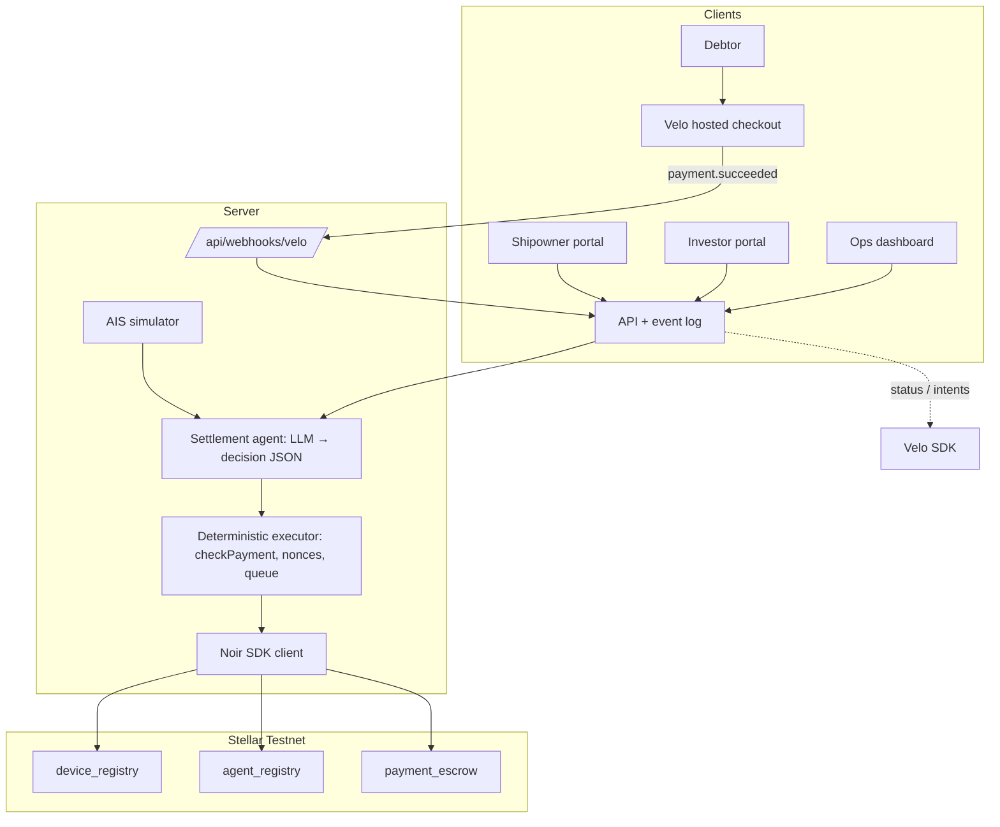

# Product Requirements Document: VisMin Inter-Island Freight Factoring Protocol

> **Codename:** NoirxVelo Freight Factoring (Bunkr VisMin) **Tracking ID:** `NV-M0-01` **Network:** Stellar Testnet, deployed Noir contracts (via the Noir SDK) + Velo **Version:** 1.2 (aligned to the Builder Handbook, updated Nov 5)

---

## 0. READ FIRST: critical corrections from the Builder Handbook

These four items would have disqualified or sunk the project if left as written in v1.1.


| #   | v1.1 said                                          | Handbook says                                                                                                                                             | Action                                                                                                        |
| --- | -------------------------------------------------- | --------------------------------------------------------------------------------------------------------------------------------------------------------- | ------------------------------------------------------------------------------------------------------------- |
| 1   | **Submissions close Sun Nov 8, 8:00 AM**           | **Submissions close Sat Nov 7, 12:00 PM (noon), PHT.** Top 10 announced Sat 4:00 PM. Face-to-face pitch Sun Nov 8, 1:00 PM to 8:00 PM.                    | Schedule rebuilt (§17). **About 16 hours remain as of Fri 7:48 PM.** Target submit by **10:30 AM Sat**.       |
| 2   | Contract IDs `CB4D…`, `CBTD…`, `CA5S…`             | Latest Testnet IDs (redeployed 2026-10-24, built into the SDK as `TESTNET`) are different. **Older IDs are retired. Other IDs do not count.**             | Replace with the IDs in §10.1. Don't hardcode: use the SDK's built-in `TESTNET` config.                       |
| 3   | Noir SDK optional; "generated bindings" as primary | Agent must call the contracts **only through** `@noirx402/agent-sdk`. Own deployments or other IDs don't count.                                           | Remove generated bindings and raw `stellar-sdk` contract calls for agent payments. SDK only (§10.2).          |
| 4   | Velo Gas Station as a P0 pillar                    | Handbook documents only **checkout sessions, payment status, signed webhooks**. The agent **pays its own fees** (about 2.3 XLM on first use of a device). | Gas Station moves to P2 and is marked **\[unverified\]**. Default: fund the agent and wallets with Friendbot. |


Also new: a public **monorepo**, a **README in the mandated template**, a **live deployed URL**, a **2-minute demo video**, a **pitch deck link**, and a **written summary** are all required for judging (§11, §20). A project registered on Luma but **not** on the Google Form is ineligible. **Confirm registration today.**

---

## Document Metadata


| Field                                          | Value                                                                                                                                                                                                                                                  |
| ---------------------------------------------- | ------------------------------------------------------------------------------------------------------------------------------------------------------------------------------------------------------------------------------------------------------ |
| **Product**                                    | VisMin Inter-Island Freight Factoring Protocol (`noirxvelo`)                                                                                                                                                                                           |
| **Status**                                     | `Draft: in review`. Becomes `Approved` after spikes S1 to S3 and S6 pass.                                                                                                                                                                              |
| **Owner (DRI)**                                | `@helenaherrero515`                                                                                                                                                                                                                                    |
| **Milestone**                                  | `M0: Hackathon`. Build Thu Nov 5 to **Sat Nov 7, 12:00 PM PHT**. Pitch Sun Nov 8, 1:00 PM (top 10 only).                                                                                                                                               |
| **Contracts (Testnet, redeployed 2026-10-24)** | `device_registry` `CAC4KOLHDLDYDWBOKXNKRN5KVHO56PLOIFXDLTBUWGVN6GVDEB7FQHU5`&lt;br&gt;`agent_registry` `CCMZDSPTLX7IIJWCYEUM5DJUHOSOYSTHGK777S2TXZWEMC5ZZGPJ3EBV`&lt;br&gt;`payment_escrow` `CC7EAW5FNJEDBS7THM5IT6XIOHO4AOYMLXT3KSZ3HWUIKEACTW7E5BFS` |
| **SDKs**                                       | `@noirx402/agent-sdk` (required), `@stellar/stellar-sdk` v16 (peer dependency), `@carts1024/velo-sdk@alpha` (the `latest` tag is an older build). Pin exact versions in `package.json` after install.                                                  |
| **Runtime**                                    | Node `^22.23.4`, `^24.22.1` or `>=26.12.1`. The Noir SDK refuses other versions under yarn. Set `engines` and `.nvmrc`.                                                                                                                                |
| **Last updated**                               | 2026-11-06                                                                                                                                                                                                                                             |


### What changed from v1.1


| Area            | v1.1                                            | v1.2                                                                                                                                                                              | Why                               |
| --------------- | ----------------------------------------------- | --------------------------------------------------------------------------------------------------------------------------------------------------------------------------------- | --------------------------------- |
| Deadline        | Sun Nov 8, 8:00 AM                              | **Sat Nov 7, 12:00 PM**                                                                                                                                                           | Handbook schedule                 |
| Contract IDs    | Retired/unknown IDs                             | Latest IDs from the handbook                                                                                                                                                      | Wrong IDs are not judged          |
| Noir access     | Optional SDK, generated bindings                | **SDK only** (`NoirAgentClient`)                                                                                                                                                  | Hard requirement #2               |
| Method names    | Raw contract names (`fund_escrow`, `authorize`) | SDK names (`registerDevice`, `registerAgent`, `fundEscrow`, `checkPayment`, `authorizePayment`, `claim`)                                                                          | Code is written against the SDK   |
| Velo calls      | Many **\[confirm\]** items                      | Confirmed from handbook: `asset: 'native'`, `{checkoutUrl, paymentIntentId}`, `paymentIntents.retrieve`, `Velo.webhooks.verify({payload, signature, secret})`, `x-velo-signature` | Removes guesswork                 |
| Webhook helpers | `verifyWebhookSignature` listed under Velo      | That helper belongs to the **Noir** SDK. Velo uses `Velo.webhooks.verify`.                                                                                                        | Corrects a mix-up                 |
| Over-cap demo   | "Show the failed on-chain tx"                   | Show `checkPayment` → `over_limit` and the SDK's `NoirContractError`. A failed tx hash is only possible if we bypass simulation **\[confirm S8\]**.                               | The SDK simulates before sending  |
| Gas Station     | P0                                              | P2, unverified                                                                                                                                                                    | Not in the handbook               |
| Deliverables    | Missing                                         | Monorepo, README template, live site, 2-min video, deck, write-up                                                                                                                 | Hard requirements #5 and #6       |
| Hosting         | SQLite                                          | Hosted DB or in-memory + seed (§14)                                                                                                                                               | Serverless hosts lose local files |
| Schedule        | 4 days                                          | **16-hour plan**                                                                                                                                                                  | Deadline moved up                 |
| Scoring         | None                                            | Each feature mapped to the judging weights (§3.4)                                                                                                                                 | Spend time where points are       |
| Pitch           | \~90 s                                          | 90 s live loop inside a **5-min pitch + 3-min Q&amp;A**, plus a **2-min video**                                                                                                   | Judging format                    |


---

## 1. Summary

### 1.1 One-sentence pitch

Philippine inter-island shipping lines get **85% of a freight invoice the day they sail**. An AI settlement agent, holding a Noir agent key with spending limits enforced on-chain, releases the advance once the e-Waybill checks out. When the cargo owner pays through a Velo checkout, the same agent repays investors and returns the reserve to the shipowner.

### 1.2 The problem

Big cargo owners pay freight on Net-60 to Net-90. Shipping lines pay for fuel, port dues and crew **before** sailing. That gap pushes small operators toward slow bank factoring or costly informal loans. Lenders hesitate: paper waybills can be pledged twice, and no one can easily confirm that cargo arrived.

### 1.3 Why this design (and why it scores)

- **Bounded agent authority (Noir).** The agent can only move money through the Noir contracts, and `agent_registry` enforces max amount, asset and expiry. This is the "constrained agent key" the handbook defines as an agentic payment.
- **Invoice = device.** Each e-Waybill hash is registered as a device that owns an escrow balance. One ledger per invoice.
- **Velo as the payer's door and source of truth.** The debtor pays by normal checkout link. Velo confirms on the ledger and sends a signed `payment.succeeded` webhook, which is the settlement trigger.
- **The agent chooses when, whom and how much.** It decides ADVANCE vs HOLD vs SETTLE, and the numbers are validated in code.

---

## 2. Problem and Pain Points

(Unchanged in substance from v1.1.)

1. Cash is locked in receivables for 60 to 90 days, which delays sailings and drives informal credit.
2. Bank factoring is slow and hard for small forwarders. **[needs source for any specific weeks or ₱ minimum]**
3. Double-pledging risk on paper waybills.
4. No delivery visibility for outside capital.

**[needs source]**: cite a PPA, MARINA or PSA figure before putting any percentage on a slide. If none is found by Sat 9:00 AM, drop the number and describe the problem qualitatively.

---

## 3. Goals and Success Criteria

### 3.1 Goals (must be true at submission)

- \[ \] **G1 Contracts.** Full lifecycle on the **latest** Testnet contracts via the SDK: `registerDevice` → `registerAgent` → `fundEscrow` → `checkPayment` → `authorizePayment` → `claim`, with revoke and sweep as P1.
- \[ \] **G2 Velo.** The debtor pays through a Velo checkout session. A verified, de-duplicated `payment.succeeded` webhook triggers settlement.
- \[ \] **G3 Agent decides.** The agent issues `ADVANCE`, `SETTLE` and `HOLD` decisions with reasons. A deterministic executor turns decisions into SDK calls.
- \[ \] **G4 Guardrail.** A live over-limit attempt is refused, with the reason shown.
- \[ \] **G5 Ship it.** Public monorepo, README in template, **live URL**, 2-min video, deck, write-up, Testnet proof links.

### 3.2 KPIs


| Metric                                                    | Target                                                                 | How we measure                                                |
| --------------------------------------------------------- | ---------------------------------------------------------------------- | ------------------------------------------------------------- |
| Advance latency (decision → `authorizePayment` confirmed) | ≤ 10 s                                                                 | Decision-log timestamps                                       |
| Escrow conservation                                       | 0 base units left after settlement                                     | `balanceOf(invoice_device) == 0` and Σ authorized == Σ funded |
| Webhook verification                                      | Valid accepted; forged, stale and duplicate rejected                   | Unit tests with fixtures                                      |
| Agent policy                                              | 0 over-cap or expired payments succeed                                 | `checkPayment` returns `over_limit` or `expired`              |
| Idempotency                                               | A replayed webhook or retry never pays twice                           | Replay test                                                   |
| Berthing detection (simulated)                            | 100% on scripted routes, 0 false positives on the offshore-anchor case | Simulation tests                                              |
| Clean-clone test                                          | A stranger can run it from the README                                  | Fresh-clone dry run before submit                             |


### 3.3 Out of scope for the hackathon

Live AIS, PHP stablecoin and off-ramp, multi-investor pool, credit scoring, risk-based pricing.

### 3.4 Judging map (where the points are)


| Criterion            | Weight  | What we show                                                                                                                           |
| -------------------- | ------- | -------------------------------------------------------------------------------------------------------------------------------------- |
| Agentic payments fit | **30%** | The LLM decision card with its reason; role-based payouts; the live over-limit refusal. The agent, not a human, triggers every payout. |
| Technical execution  | **25%** | Velo and Noir work end to end on Testnet; explorer links; escrow balance reaches 0.                                                    |
| Innovation           | 20%     | Invoice-as-device, so a receivable becomes a bounded on-chain escrow.                                                                  |
| Real-world potential | 15%     | Clear user (small shipping line), clear pain, honest limits (§9.3).                                                                    |
| Pitch and demo       | 10%     | Lead with "₱850k for fuel the day they sail"; live loop plus backup video.                                                             |


**Priority rule:** anything that doesn't raise one of these rows is cut first.

---

## 4. Non-Goals

- No mainnet or real funds.
- No fiat custody. PDAX and bank rails are roadmap items only.
- No ML underwriting. Eligibility is deterministic rules (§8.3).
- No pool contract. One LP per invoice.
- No physical inspection. Simulated AIS only.
- **No deploying our own contracts and no calling other contract IDs.** It voids the Noir requirement.

**Scope freeze rule (revised):** once the full loop (Tokenize → Advance → Berth → Pay → Settle → Claim) has run cleanly **twice** on Testnet against the **deployed** app with recorded tx hashes, freeze the core. Three runs is the ideal, but time is short.

---

## 5. Personas


| Persona                            | Need                            | What they get                                               | Screen           |
| ---------------------------------- | ------------------------------- | ----------------------------------------------------------- | ---------------- |
| **Shipowner / forwarder CFO**      | Cash for fuel and port fees now | 85% advance at departure and the reserve back at settlement | Shipowner portal |
| **Liquidity provider**             | Short-tenor yield               | Principal plus fixed yield (3% of face, demo)               | Investor portal  |
| **Cargo owner (debtor) treasurer** | Pay without touching crypto     | A hosted checkout link                                      | Velo checkout    |
| **Settlement agent**               | Clear inputs, bounded authority | Decides advance and settlement within on-chain limits       | Agent log        |
| **Protocol ops**                   | Handle exceptions               | Hold queue, simulate-webhook button, revoke and sweep       | Ops              |


---

## 6. Principles and Invariants

1. **Least privilege.** The agent key signs `authorizePayment` only, within the invoice's `agent_registry` policy. The treasury key is never given to the LLM.
2. **The LLM proposes and the executor acts.** The model returns a schema-validated decision. Code checks preconditions, builds and submits. If any check fails, nothing is sent.
3. **Integer accounting.** Amounts are `bigint` stroops via `toStroops` and `fromStroops`. Never floats. Yield and fee round down; the shipowner rebate takes the remainder, so the parts sum to V exactly.
4. **Two gates.** *Advance gate:* waybill hash newly registered, debtor known, vessel underway. *Settlement gate:* verified Velo `payment.succeeded` for this invoice **and** a berthing attestation.
5. **Fail closed.** On any anomaly the agent returns `HOLD`. Ops can revoke the agent policy. Funds stay in escrow under treasury control.
6. **Exactly-once payments.** Deterministic nonces and idempotent webhooks (§10.4).
7. **Check before paying.** The executor calls `checkPayment` before every `authorizePayment`. A refusal becomes a `HOLD` with the returned reason.
8. **Keys stay on the server.** Agent and demo-wallet secrets live in server env only. Never in the browser, never in git.

---

## 7. Scope

### 7.1 P0 (must ship, in this order)

1. **P0-1 Repo, deploy skeleton, env.** Monorepo (§14.1) deployed to a public URL **tonight** with a "hello" page. Don't leave deploy to Saturday.
2. **P0-2 Provisioning script.** Friendbot-funds treasury, shipowner, LP, debtor, **agent (also pays fees)** and relayer. Prints Stellar Expert links.
3. **P0-3 Chain module** (`packages/agent`). Wraps `NoirAgentClient`: `registerDevice`, `registerAgent`, `fundEscrow`, `checkPayment`, `authorizePayment`, `claim`, `balanceOf`/`pendingBalance` (names **[confirm S1]**).
4. **P0-4 Tokenize.** Compute `invoice_hash = sha256(canonical_waybill_json)`, then `registerDevice` and `registerAgent` (cap, asset = native XLM SAC, expiry).
5. **P0-5 Advance.** LP `fundEscrow`, the agent decides `ADVANCE`, the executor runs `checkPayment` then `authorizePayment`, and the shipowner `claim`s.
6. **P0-6 Debtor checkout and webhook.** `velo.checkout.sessions.create`, then `Velo.webhooks.verify` on the raw body, de-dupe, and treasury `fundEscrow` for V.
7. **P0-7 Settlement.** The agent decides `SETTLE` and the executor makes three sequential `authorizePayment` calls (LP, shipowner rebate, treasury fee). Payees `claim`.
8. **P0-8 Guardrail demo.** Show `checkPayment` → `over_limit` for a V-sized payout.
9. **P0-9 Voyage simulator and berthing check** (§8.2). Simple progress bar first, map second.
10. **P0-10 Dashboard.** Status badges, decision log with reasons, explorer link on every step.
11. **P0-11 Submission pack.** README, video, deck, write-up (§20).

### 7.2 P1 (stretch, only after the loop runs twice)

- Event feed via `[noir.watch](http://noir.watch)({ types: ['payment.authorized'], onEvent })` for the live dashboard (else poll balances).
- `DEFAULT` path: revoke the agent policy and sweep funds back to the treasury **\[SDK method names: confirm S1\]**.
- Leaflet map animation.
- LLM-parsed waybill (schema-checked).

### 7.3 P2 / Later

Gas Station sponsorship **[unverified]**, multi-route, pool contract, live AIS, PHP stablecoin, legal assignment workflow.

### 7.4 Cut order if behind

P2 → LLM waybill → map animation (use progress bar) → multi-route → `DEFAULT` path → event streaming (poll instead). **Never cut:** tokenize → advance → pay → settle → claim → over-limit refusal → live URL → README.

---

## 8. Settlement Agent

### 8.1 State machine

```mermaid
stateDiagram-v2
    [*] --> TOKENIZED: registerDevice + registerAgent
    TOKENIZED --> FUNDED: LP fundEscrow
    FUNDED --> ADVANCED: agent ADVANCE → authorizePayment(shipowner)
    ADVANCED --> IN_TRANSIT: AIS underway
    IN_TRANSIT --> BERTHED: geofence + SOG rule met
    IN_TRANSIT --> HOLD: AIS dark > 12h / deviation
    BERTHED --> PAID: verified Velo webhook → treasury fundEscrow
    PAID --> SETTLED: agent SETTLE → 3× authorizePayment
    SETTLED --> CLOSED: payees claim; balance == 0
    BERTHED --> DEFAULT: due date + grace passed
    DEFAULT --> CLOSED: revoke agent → sweep (P1)
    HOLD --> IN_TRANSIT: ops clears

```

### 8.2 Telemetry and berthing rule (simulated)

- Local simulator replays GeoJSON tracks. No external API, so the demo cannot fail. Tick every 2 s in the demo (compress further for the video).
- Origin: Manila South Harbor (14.580° N, 120.965° E). Destination geofence: Port of Cebu (10.3015° N, 123.9080° E), 800 m radius. **[verify on a map]**
- **Berthed** = inside the geofence **and** SOG ≤ 0.5 kn for 3 consecutive ticks. Anchored offshore must **not** count (test case).
- Attestation: the agent signs `{invoiceId, mmsi, port, berthTimestamp, lat, lng, sog}`. The record and its hash go into the event log and are shown beside the settlement tx. Nothing is written on-chain.
- **Honesty note:** AIS can be spoofed. Settlement also requires the debtor's payment. Production would add terminal discharge data.

### 8.3 Decision contract

```json
{
  "$schema": "http://json-schema.org/draft-07/schema#",
  "title": "AgentDecision",
  "type": "object",
  "required": ["invoiceId", "decision", "reason", "payouts"],
  "additionalProperties": false,
  "properties": {
    "invoiceId": { "type": "string", "pattern": "^INV-[0-9]{4}-[0-9]{3}$" },
    "decision": { "enum": ["ADVANCE", "SETTLE", "HOLD", "DEFAULT"] },
    "reason": { "type": "string", "maxLength": 280 },
    "payouts": {
      "type": "array",
      "items": {
        "type": "object",
        "required": ["role", "amountStroops"],
        "additionalProperties": false,
        "properties": {
          "role": { "enum": ["SHIPOWNER", "LP", "TREASURY"] },
          "amountStroops": { "type": "string", "pattern": "^[0-9]+$" }
        }
      }
    }
  }
}

```

The model returns **roles, not addresses**. The executor maps roles to stored addresses, so the LLM can never pay an arbitrary wallet. The model also never sees secrets.


| Decision  | Preconditions (checked in code)                                                                              | Allowed payouts                                                    |
| --------- | ------------------------------------------------------------------------------------------------------------ | ------------------------------------------------------------------ |
| `ADVANCE` | State `FUNDED`, escrow balance ≥ advance, AIS underway, hash registered by us, `checkPayment.ok`             | `SHIPOWNER = α·V`                                                  |
| `SETTLE`  | State `PAID`, webhook verified, amount == V, berthing attestation present, `checkPayment.ok` for each payout | `LP = α·V + y·V`, `SHIPOWNER = rebate`, `TREASURY = f·V`, sum == V |
| `HOLD`    | Any precondition fails or an anomaly is flagged                                                              | none                                                               |
| `DEFAULT` | Due date + grace passed, no payment                                                                          | none (ops revokes and sweeps)                                      |


If the model's payouts differ from the code-computed amounts, the executor **rejects the decision and logs it**. The model explains; code computes.

**Judging note (30% criterion):** keep the real LLM call in the main path so judges see the agent actually deciding. The rules-engine fallback is for outages only, and the log marks it `fallback`.

### 8.4 Degradation

- **AIS gap:** `HOLD` with `telemetry_lag`. Never auto-forfeit.
- **Webhook missing:** poll `velo.paymentIntents.retrieve(paymentIntentId)` (**confirmed in handbook**) and offer a "re-poll" button. Also keep a "simulate webhook" button, marked as a demo tool.
- `checkPayment` **not ok** (`over_limit`, `expired`, `insufficient_escrow`): `HOLD` with that reason.
- **Fee or account errors:** verify the account exists and holds XLM. Top up from Friendbot.
- **LLM down or invalid output:** deterministic rules engine decides; log marked `fallback`.

---

## 9. Security and Data

### 9.1 Data classification


| Data                                           | Where                                        | Public?   |
| ---------------------------------------------- | -------------------------------------------- | --------- |
| Invoice hash, amounts, payout txs              | On-chain                                     | Yes       |
| Vessel MMSI/IMO, positions                     | Event log (simulated)                        | Yes       |
| Cargo SKU/pricing, debtor tax ID               | Off-chain DB only; salted hash if ever shown | **No**    |
| Agent, treasury and demo-wallet secrets        | Server env only                              | **Never** |
| `VELO_API_KEY`, `VELO_WEBHOOK_SECRET`, LLM key | Server env only                              | **Never** |


Never commit a secret. Rule 3 of the code of conduct allows disqualification. Add `.env` to `.gitignore` **before the first commit**, and keep every variable (empty) in `.env.example`.

### 9.2 Threats


| Threat                             | Mitigation                                                                                                                                                                                                                                                      |
| ---------------------------------- | --------------------------------------------------------------------------------------------------------------------------------------------------------------------------------------------------------------------------------------------------------------- |
| **T-1 AIS spoofing**               | Settlement also needs debtor payment; geofence + SOG + dwell; state the limit openly.                                                                                                                                                                           |
| **T-2 Double-factoring**           | Register the hash in `device_registry`; test whether a duplicate is rejected (S3); also enforce a unique hash in our DB. Cross-lender protection needs other lenders to check the same registry.                                                                |
| **T-3 Agent key compromise**       | Per-payment cap and expiry; payees fixed by role; one invoice per device; ops can revoke. **The cap is per payment, not a running total**, so repeated capped payments could drain one invoice's escrow. Off-chain daily limit and alerts cover that.           |
| **T-4 Forged or replayed webhook** | `Velo.webhooks.verify` on the **raw, unparsed body**; bad signature → 400 and ignore (`VeloWebhookSignatureVerificationError`); de-dupe by event ID; match amount and invoice to the open session; 300 s window if a timestamp is available **\[confirm S6\]**. |
| **T-5 Double payout from retries** | Deterministic nonces and one in-flight payment per agent.                                                                                                                                                                                                       |
| **T-6 Debtor default**             | LP bears the loss in the MVP, disclosed in the investor UI.                                                                                                                                                                                                     |


### 9.3 Compliance note (not legal advice)

Factoring is generally a regulated financing activity in the Philippines, and invoice-backed tokens sold to investors may be treated as securities (SEC). Present the project as a Testnet prototype and list "regulatory pathway (SEC financing company licence / sandbox)" under *What's next*.

---

## 10. Contracts and Integration

### 10.1 Deployed contracts (do not change)


| Contract          | Role                                           | Testnet ID                                                 |
| ----------------- | ---------------------------------------------- | ---------------------------------------------------------- |
| `device_registry` | Maps a device hash to its owner wallet         | `CAC4KOLHDLDYDWBOKXNKRN5KVHO56PLOIFXDLTBUWGVN6GVDEB7FQHU5` |
| `agent_registry`  | Agent policy: max amount, asset, expiry        | `CCMZDSPTLX7IIJWCYEUM5DJUHOSOYSTHGK777S2TXZWEMC5ZZGPJ3EBV` |
| `payment_escrow`  | Holds funds; agent authorizes, merchant claims | `CC7EAW5FNJEDBS7THM5IT6XIOHO4AOYMLXT3KSZ3HWUIKEACTW7E5BFS` |


Use the SDK's built-in `TESTNET` config so IDs can't drift. The retired 2026-10-07 IDs must not appear anywhere in the repo.

### 10.2 SDK call map (the only way the agent touches the chain)


| Step                       | SDK call                                                                                      | Signer                    | Notes                                                                                                 |
| -------------------------- | --------------------------------------------------------------------------------------------- | ------------------------- | ----------------------------------------------------------------------------------------------------- |
| Register invoice as device | `registerDevice`                                                                              | treasury `keypairSigner`  | Takes a hash of the tag UID in Noir's own flow. We pass `invoice_hash`. **\[confirm arg shape, S1\]** |
| Set agent policy           | `registerAgent` (asset, `maxAmount`, `expiresAt`)                                             | treasury                  | `maxAmount` caps **each** payment                                                                     |
| Fund                       | `fundEscrow`                                                                                  | LP, then treasury         | Token is fixed per device at first funding                                                            |
| Pre-check                  | `checkPayment({deviceHash, agent, asset, amount})`                                            | none (read)               | Returns `{ok:true}` or a reason: `over_limit`, `expired`, `insufficient_escrow`                       |
| Pay                        | `authorizePayment({agent: keypairSigner(AGENT_SECRET), deviceHash, merchant, asset, amount})` | agent                     | Moves funds to the merchant's **pending** balance                                                     |
| Collect                    | `claim`                                                                                       | shipowner / LP / treasury | Pays out everything pending for that merchant                                                         |
| Events                     | `[noir.watch](http://noir.watch)(...)`, `startWebhookRelay`                                   | none                      | Verify deliveries with Noir's `verifyWebhookSignature`; dedupe on [`event.id`](http://event.id)       |
| Revoke / sweep / defund    | **\[confirm names, S1\]**                                                                     | treasury                  | P1 only                                                                                               |


Errors surface as `NoirContractError` with names like `InsufficientBalance`, `AgentNotAuthorized`, `NothingToClaim`. Log them in the decision log.

> Because `claim` pays everything pending across devices, use **separate demo wallets per role** so each claim reads cleanly on the explorer.

### 10.3 Mapping factoring onto the escrow


| Factoring concept | On-chain primitive                                                                                                |
| ----------------- | ----------------------------------------------------------------------------------------------------------------- |
| Invoice           | Device (`deviceHash = sha256(waybill)`) owned by the treasury                                                     |
| Agent mandate     | Policy: `maxAmount = α·V + y·V` (largest single payout), `asset = native XLM SAC`, `expiresAt = due date + grace` |
| LP advance        | LP `fundEscrow(α·V)` → agent `authorizePayment(shipowner, α·V)` → shipowner `claim`                               |
| Debtor payment    | Velo checkout → treasury receives → treasury `fundEscrow(V)`                                                      |
| Settlement        | Agent `authorizePayment` ×3 (LP, shipowner, treasury) → each `claim`s                                             |
| Guardrail demo    | `checkPayment(… amount = V)` → `over_limit`                                                                       |


### 10.4 Demo currency (decision D-1, locked)

- Settle in **testnet XLM** via `Asset.native().contractId(Networks.TESTNET)`.
- UI shows PHP at a fixed **demo rate, 1 XLM = ₱1,000**, labeled everywhere. ₱1,000,000 = 1,000 XLM.
- Friendbot gives 10,000 XLM per account, so balances are fine. **Never drain an account to zero** (minimum reserve).
- **Fund the agent account generously.** Soroban fees run about 2.3 XLM on the first tap of a device, and the agent pays them. Also fund shipowner, LP and treasury, since each pays its own `claim` and `fundEscrow` fees.
- No test-asset alternative. Decision closed.

### 10.5 Nonces and idempotency

- Treat nonces as a strictly increasing sequence per (invoice device, agent) **[confirm S1 whether the SDK manages nonces for you]**. If the SDK handles them, store the returned tx hash per step instead.
- One `authorizePayment` in flight per agent: use an async mutex or queue.
- Store `(invoice_id, step) → nonce/tx hash` before submitting. On retry, reuse it.
- Webhooks: de-dupe by event ID before any side effect.

### 10.6 Velo integration (confirmed against the handbook)

```typescript
import { Velo } from "@carts1024/velo-sdk";

const velo = new Velo({ apiKey: process.env.VELO_API_KEY!, environment: "testnet" });

export async function createDebtorCheckout(inv: Invoice) {
  const { checkoutUrl, paymentIntentId } = await velo.checkout.sessions.create({
    amount: toAssetAmount(inv.faceValueStroops), // "1000.0000000"; the asset's units, not PHP
    asset: "native",                             // confirmed value (not "XLM")
    description: `Freight invoice ${inv.id}`,
    successUrl: `${process.env.APP_URL}/pay/success?invoiceId=${inv.id}`,
    cancelUrl: `${process.env.APP_URL}/pay/cancel?invoiceId=${inv.id}`,
  });
  // save paymentIntentId -> invoice.id mapping; return checkoutUrl
  return { checkoutUrl, paymentIntentId };
}

export async function pollPayment(paymentIntentId: string) {
  return (await velo.paymentIntents.retrieve(paymentIntentId)).status;
}

// Webhook route: pass the RAW body, never a parsed one
export async function handleVeloWebhook(req: Request) {
  const rawBody = await req.text();
  try {
    const event = await Velo.webhooks.verify({
      payload: rawBody,
      signature: req.headers.get("x-velo-signature")!,
      secret: process.env.VELO_WEBHOOK_SECRET!,
    });
    // dedupe by event id -> match paymentIntentId to invoice -> check amount -> enqueue treasury fundEscrow
    return new Response("ok");
  } catch {
    return new Response("invalid signature", { status: 400 }); // VeloWebhookSignatureVerificationError
  }
}

```

- The webhook endpoint must be **publicly reachable**, so deploy first. Register the deployed URL in the Velo dashboard ([velo-build.dev](http://velo-build.dev)).
- Velo SDK is alpha and **server-side only**. Never import it in client components.
- **Open (S4):** which address receives a checkout payment? Plan stays: treasury receives, then treasury calls `fundEscrow`.
- **Open (S6):** exact event field names (event ID, session/intent ID, amount) from a real delivery. Log one raw payload on the first test.

### 10.7 Math

V = face value, α = 0.85, y = 0.03·V, f = 0.005·V.

- Advance = ⌊α·V⌋
- LP repayment = Advance + ⌊y·V⌋
- Fee = ⌊f·V⌋
- Shipowner rebate = V − LP repayment − Fee (absorbs rounding)

**Yield, stated correctly:** the LP deploys α·V and earns y·V, so the return on capital is y/α = 3.53% over 60 days, about **21.5% simple annualized**.


| Step            | From → To                             | Demo ₱    | XLM   |
| --------------- | ------------------------------------- | ---------: | -----: |
| LP funds escrow | LP → escrow                           | 850,000   | 850   |
| Advance         | escrow → shipowner                    | 850,000   | 850   |
| Debtor pays     | debtor → Velo → treasury → escrow     | 1,000,000 | 1,000 |
| LP repayment    | escrow → LP                           | 880,000   | 880   |
| Rebate          | escrow → shipowner                    | 115,000   | 115   |
| Fee             | escrow → treasury                     | 5,000     | 5     |
| **Check**       | `balanceOf(invoice)` after settlement | **0**     | **0** |


Policy cap: `maxAmount = 880 XLM`. Guardrail demo tries 1,000 XLM, so `checkPayment` returns `over_limit`.

> **Balance caution:** the escrow holds the advance's funds only until paid out. After the advance, the escrow is 0, then the treasury refunds it with V = 1,000. Check `balanceOf` between steps, because `insufficient_escrow` is a real failure mode.

---

## 11. Hackathon Requirement Map (all six must pass)


| #   | Handbook requirement                                                  | How we meet it                                                                     | Evidence                                           |
| --- | --------------------------------------------------------------------- | ---------------------------------------------------------------------------------- | -------------------------------------------------- |
| 1   | Agentic payment: an AI agent decides, requests or makes the payment   | Settlement agent decides and signs `authorizePayment` with a constrained agent key | Decision log, tx links                             |
| 2   | Noir strictly via `@noirx402/agent-sdk` on the **deployed** contracts | SDK only, IDs from §10.1, no custom deployments                                    | README *Noir integration* with file and line links |
| 3   | Velo SDK for the rest of the app                                      | Checkout sessions, payment status, signed webhooks                                 | README *Velo integration* with file links          |
| 4   | Stellar Testnet, no real funds                                        | Testnet only                                                                       | Stellar Expert links                               |
| 5   | Public GitHub **monorepo** + README in the template                   | §14.1 layout, §20 README                                                           | Repo link                                          |
| 6   | Live public website                                                   | Deployed web and server                                                            | URL in README and submission                       |


The judges check the *Noir integration*, *Velo integration* and *Testnet proof* README sections **against the code**. Links must point to real files and lines. Update the line links after the final commit.

---

## 12. Functional Requirements


| ID    | Area       | Requirement                                           | P   | Acceptance check                                      |
| ----- | ---------- | ----------------------------------------------------- | :---: | ----------------------------------------------------- |
| FR-01 | Chain      | One module wraps all SDK calls (§10.2)                | P0  | Lifecycle script prints tx links                      |
| FR-02 | Tokenize   | Waybill submitted → device and policy registered      | P0  | Readable on-chain; resubmit is rejected (chain or DB) |
| FR-03 | Fund       | LP funds the advance                                  | P0  | `balanceOf(invoice) == α·V`                           |
| FR-04 | Advance    | Agent advances after the gate                         | P0  | `authorizePayment` tx + `claim` tx                    |
| FR-05 | Telemetry  | Simulator + berthing rule                             | P0  | Berth detected; offshore-anchor case not              |
| FR-06 | Checkout   | Debtor session created                                | P0  | `checkoutUrl` opens; payment completes on Testnet     |
| FR-07 | Webhook    | Verified, de-duped webhook → `PAID`                   | P0  | Forged, stale and duplicate rejected in tests         |
| FR-08 | Settle     | Three payouts sum to V                                | P0  | Balance 0; three authorize events; claims succeed     |
| FR-09 | Guardrail  | Over-limit payout refused                             | P0  | UI shows `over_limit` and the SDK error               |
| FR-10 | Dashboard  | Badges, reasons, explorer links                       | P0  | Every demo step has a clickable link                  |
| FR-11 | Deploy     | Public URL serves web and webhook                     | P0  | Webhook delivery reaches the deployed server          |
| FR-12 | Submission | README, video, deck, write-up                         | P0  | §20 ticked                                            |
| FR-13 | Events     | [`noir.watch`](http://noir.watch) feeds the dashboard | P1  | Live update without refresh                           |
| FR-14 | Default    | Revoke and sweep                                      | P1  | Treasury balance restored                             |
| FR-15 | Gas        | Gas Station sponsorship                               | P2  | Unverified; skip unless time remains                  |


---

## 13. UX

- **Badges:** `TOKENIZED → FUNDED → ADVANCED → IN_TRANSIT → BERTHED → PAID → SETTLED`, plus `HOLD` (amber) and `DEFAULT` (red).
- **Role switcher** in the header: Shipowner / Investor / Debtor / Ops, each with its own demo wallet.
- **Decision cards:** decision, one-line reason, amounts, tx link. Click to show raw JSON and attestation. This is the 30% evidence, so make it prominent.
- **Demo-rate label** next to every PHP amount.
- **Seed data is fictional:** *MV VisMin Pioneer* (Manila→Cebu, ₱1,000,000, Net-60) for *Isla Beverages Corp.*; *MV Mindanao Express* (Cebu→CDO, ₱750,000, Net-45); *MV Archipelago Star* (Manila→Davao, ₱1,500,000, Net-90). Only the first is required.
- **No blank states.** Everything works from seed data.
- **One-click "Run demo" mode** that drives the story with real calls (needed for the 2-min video and the live pitch).

### Demo script (live loop ~90 s, inside the 5-min pitch)

1. Shipowner tokenizes the invoice (device and policy links appear).
2. Investor funds ₱850k; the agent explains `ADVANCE`; advance tx and claim appear.
3. Ship sails and berths at Cebu; the attestation card appears.
4. Debtor pays via Velo checkout; the webhook is verified; the escrow is funded.
5. The agent attempts a ₱1M payout; **the Noir policy refuses it** (`over_limit`).
6. The agent explains `SETTLE`; three payouts and claims follow; the escrow balance reads **0**.

### 2-minute video (required)

0:00 to 0:15 problem ("₱850k for fuel the day they sail") → 0:15 to 1:45 steps 1 to 6 above, with the decision cards on screen → 1:45 to 2:00 stack and what's next. It must **show the agent making the payment**. Record it Saturday morning, and keep an earlier take as a fallback.

### Pitch (top 10 only, Sun 1:00 PM)

5 minutes with a live demo, then 3 minutes of Q&amp;A. Bring a laptop with the demo running and the backup video. Prepare Q&amp;A answers for: spoofed AIS, double-factoring, debtor default, SEC/regulation, why not a normal DeFi loan.

---

## 14. Architecture and Stack

### 14.1 Monorepo layout (handbook-compliant)

```
noirxvelo/
├── apps/
│   ├── web/          # Next.js frontend (live site)
│   └── server/       # API, Velo webhook, agent runtime, executor, simulator
├── packages/
│   ├── agent/        # decision schema, executor, Noir SDK calls
│   └── shared/       # types, math, config, seed data
├── scripts/          # provision.ts, lifecycle.ts
├── docs/             # spikes.md, screenshots, architecture diagram
├── .env.example
├── .nvmrc
├── package.json      # workspaces; one `npm install` at root
└── README.md         # judging README (template in §20)

```

If time is very short, a single Next.js app with route handlers inside `apps/web` is acceptable **only if** the monorepo shape and workspaces remain. Webhook and agent runtime can live in route handlers.




| Layer          | Choice                                                                                                                                                                                                                                                    |
| -------------- | --------------------------------------------------------------------------------------------------------------------------------------------------------------------------------------------------------------------------------------------------------- |
| App            | Next.js (App Router) + TypeScript, Tailwind                                                                                                                                                                                                               |
| DB / event log | **Not local SQLite on a serverless host** (files don't persist). Use a hosted option (Turso, Neon, Vercel Postgres) **or** a persistent host (Render/Railway) with SQLite on a disk. Fastest: Render or Railway for `apps/server`, Vercel for `apps/web`. |
| Chain          | `@noirx402/agent-sdk` + `@stellar/stellar-sdk` v16; Horizon and RPC defaults come from the SDK                                                                                                                                                            |
| Payments       | `@carts1024/velo-sdk@alpha` (server only)                                                                                                                                                                                                                 |
| Agent          | Any tool-calling LLM behind the decision schema, with a rules-engine fallback                                                                                                                                                                             |
| Map            | Progress bar first; Leaflet later                                                                                                                                                                                                                         |


---

## 15. Testing

1. **Unit:** math (parts sum to V for random V); decision validator; webhook verify (valid, forged, stale, duplicate); berthing rule.
2. **Testnet integration:** lifecycle script; `checkPayment` over-limit; `NothingToClaim` on a second claim; `claim` pays the expected pending amount.
3. **End to end on the deployed app:** full loop **twice** with recorded hashes.
4. **Clean-clone test:** fresh clone, `npm install`, copy `.env.example`, run. Fix the README where it fails.
5. **Demo insurance:** pre-funded accounts, backup video, "simulate webhook" button.
6. **Secret scan** before the public push (`git log -p | grep -i secret` or gitleaks).

---

## 16. Spikes (run tonight, 90 minutes max total)


| ID     | Question                                                                                                                                 | Fallback                                                                                                                            |
| ------ | ---------------------------------------------------------------------------------------------------------------------------------------- | ----------------------------------------------------------------------------------------------------------------------------------- |
| S1     | Exact SDK method names and args for `registerDevice`, `registerAgent`, balance reads, revoke, sweep, defund; does the SDK handle nonces? | Read [`github.com/noirx402/noir`](http://github.com/noirx402/noir) SDK README and `check-and-pay.ts`. Adjust the chain module only. |
| S2     | Can the LP (not the device owner) `fundEscrow` the invoice device?                                                                       | LP pays the treasury, which funds the escrow.                                                                                       |
| S3     | Does `registerDevice` reject a duplicate hash?                                                                                           | DB uniqueness; state on-chain uniqueness as roadmap.                                                                                |
| S4     | Where does a Velo checkout payment settle (address, asset)? Is `asset: 'native'` accepted?                                               | Treasury receives, then funds the escrow.                                                                                           |
| S6     | Real webhook payload: event ID, intent ID, amount fields, timestamp                                                                      | Log the raw payload; verify per handbook.                                                                                           |
| S8     | Does the SDK let us submit an over-cap `authorizePayment` that reverts on-chain, or does simulation stop it first?                       | Show `checkPayment` → `over_limit` plus the SDK error (accepted for judging).                                                       |
| ~~S5~~ | Gas Station allow-list                                                                                                                   | **Dropped** (P2).                                                                                                                   |
| ~~S7~~ | Noir SDK vs bindings                                                                                                                     | **Closed**: the SDK is mandatory.                                                                                                   |


Record answers in `docs/[spikes.md](http://spikes.md)` as you go. Ask in Discord `#noir-sdk-and-extension` and `#velo-integration` early; teams answer during the build.

---

## 17. Schedule (Manila time; submission closes Sat Nov 7, 12:00 PM)


| Window                      | Goal                                                                                                                                                                                          | Exit criterion                                           |
| --------------------------- | --------------------------------------------------------------------------------------------------------------------------------------------------------------------------------------------- | -------------------------------------------------------- |
| **Fri 8:00 to 9:30 PM**     | Confirm registration. Create monorepo, `.gitignore`, `.env.example`, `.nvmrc`. Install both SDKs. Deploy hello-world web + server. Run S1, S3, S4. Join the 9:00 PM kickoff if still running. | Public URL live; SDK imports work                        |
| **Fri 9:30 PM to 12:30 AM** | Provisioning script; tokenize → fund → `checkPayment` → `authorizePayment` → `claim` on Testnet                                                                                               | A real `authorizePayment` and `claim` land; hashes saved |
| **Fri 12:30 to 3:30 AM**    | Velo checkout + webhook (deployed URL registered); treasury refund; three-payout settlement; decision-agent with LLM + executor                                                               | Full loop once on the deployed app                       |
| **Sat 3:30 to 7:30 AM**     | **Sleep.** (An exhausted team ships bugs.) If you can't, do the guardrail + simulator only.                                                                                                   | Rested                                                   |
| **Sat 7:30 to 9:30 AM**     | Guardrail demo, dashboard with explorer links, simulator, "Run demo" mode, second clean loop                                                                                                  | Loop clean 2× on the live URL. **Code freeze 9:30 AM.**  |
| **Sat 9:30 to 10:45 AM**    | README (template), screenshots, architecture diagram, record 2-min video, deck, write-up, secret scan, clean-clone test                                                                       | All §20 items ready                                      |
| **Sat 10:45 to 11:15 AM**   | **Submit** at [`forms.gle/hQ73PnsR1w2YwAq57`](http://forms.gle/hQ73PnsR1w2YwAq57). One representative submits.                                                                                | Confirmation received                                    |
| Sat 11:15 AM to 12:00 PM    | **Buffer only.** No new features.                                                                                                                                                             | —                                                        |
| Sat 4:00 PM                 | Top 10 announced                                                                                                                                                                              | —                                                        |
| Sun                         | Pitch rehearsal, demo on a laptop, backup video, Q&amp;A prep. Face-to-face at 1:00 PM.                                                                                                       | —                                                        |


---

## 18. Team


| Area                             | Lead                | Backup |
| -------------------------------- | ------------------- | ------ |
| Product, pitch, frontend, README | `@helenaherrero515` | —      |
| Chain module and provisioning    | *TBD*               | —      |
| Velo checkout and webhooks       | *TBD*               | —      |
| Agent, executor, simulator       | *TBD*               | —      |


All members must be listed with names and Discord handles and must be **registered through the Google Form** (teams of 2 to 4). With two people, combine chain + Velo, and agent + frontend.

---

## 19. Risks


| ID    | Risk                                          | Impact | Mitigation                                         | Owner   |
| ----- | --------------------------------------------- | :------: | -------------------------------------------------- | ------- |
| R-00  | **Deadline is 12:00 PM Sat, not Sun 8:00 AM** | High   | §17 schedule; target submit 10:45 AM               | All     |
| R-00b | **Not registered on the Google Form**         | High   | Check the confirmation email now                   | Product |
| R-01  | SDK method names differ from §10.2            | High   | S1 first; all calls behind one module              | Chain   |
| R-02  | Velo checkout can't feed the escrow directly  | Med    | Treasury hop (S4)                                  | Velo    |
| R-03  | Webhook can't reach a localhost server        | High   | Deploy tonight and register the public URL         | Velo    |
| R-04  | Testnet/RPC slow during demo                  | High   | Retries, cached state, backup video                | Backend |
| R-05  | Nonce collision or double submit              | Med    | Per-agent queue                                    | Agent   |
| R-06  | Judges lost in maritime and finance jargon    | High   | Lead with the ₱850k-for-fuel line                  | Product |
| R-07  | Regulatory questions in Q&amp;A               | Med    | §9.3                                               | Product |
| R-08  | Agent account runs out of XLM for fees        | Med    | Fund at 10,000 XLM; check balance before each run  | Chain   |
| R-09  | Secret committed to GitHub                    | High   | `.gitignore` first; secret scan before push        | All     |
| R-10  | Local DB lost on deploy                       | Med    | Hosted DB or persistent host (§14)                 | Backend |
| R-11  | README links point to wrong lines             | Med    | Update after the final commit; judges check them   | Product |
| R-12  | Testnet reset wipes state                     | Med    | `provision.ts` + `lifecycle.ts` rebuild everything | Chain   |


---

## 20. Submission Pack (due Sat Nov 7, 12:00 PM; internal target 10:45 AM)

### Checklist

- \[ \] Registered via Google Form (all members) before Nov 4, 11:59 PM
- \[ \] Public GitHub **monorepo**, root README in the template below, workspaces declared, one-command install
- \[ \] Uses `@noirx402/agent-sdk` on the **latest** contracts (§10.1), `@carts1024/velo-sdk`, Stellar Testnet only
- \[ \] **Live website URL** (deployed, reachable, webhook endpoint public)
- \[ \] 2-minute demo video showing the agent making the payment
- \[ \] Pitch deck link (Google Slides, Canva or PDF, viewable by anyone with the link)
- \[ \] Short write-up: problem, how the agent works, payment flow through Velo and Noir
- \[ \] Team names and Discord handles
- \[ \] At least one Stellar Expert transaction link (aim for the full happy path)
- \[ \] `docs/[spikes.md](http://spikes.md)`, `.env.example`, no secrets in git
- \[ \] Clean-clone test passed

### README skeleton (copy to root, in this order)

```markdown
# VisMin Freight Factoring (NoirxVelo)
One-line pitch.
**Live website:** https://...
**Demo video (2 min):** https://...
**Pitch deck:** https://...
**Team:** Name (Discord), Name (Discord)

## Problem            (2 to 4 sentences)
## Solution
## How the agentic payment works   (agent decides ADVANCE/SETTLE/HOLD; when, whom, how much)
## Architecture       (Mermaid diagram from §14)
## Noir integration   (SDK version; contracts: device_registry, agent_registry, payment_escrow; methods with file:line links)
## Velo integration   (SDK version; checkout, payment status, webhooks; file links)
## Testnet proof      (Stellar Expert links: advance, settle, claims)
## Repo structure
## Run it locally     (Node version, wallet, Testnet XLM; npm install; cp .env.example .env; start command)
## Environment variables   (| Name | What it is | Where to get it |)
## Screenshots
## What's next        (live AIS, PHP stablecoin, pool contract, SEC pathway)
## Credits

```

### Environment variables (for `.env.example`)


| Name                                                                | What it is             | Where to get it                                   |
| ------------------------------------------------------------------- | ---------------------- | ------------------------------------------------- |
| `VELO_API_KEY`                                                      | Velo Testnet API key   | [velo-build.dev](http://velo-build.dev) dashboard |
| `VELO_WEBHOOK_SECRET`                                               | Verifies Velo webhooks | Velo dashboard                                    |
| `AGENT_SECRET`                                                      | Agent signing key      | `scripts/provision.ts`                            |
| `TREASURY_SECRET`, `SHIPOWNER_SECRET`, `LP_SECRET`, `DEBTOR_SECRET` | Demo wallets           | `scripts/provision.ts`                            |
| `LLM_API_KEY`                                                       | Agent model            | LLM provider                                      |
| `APP_URL`                                                           | Public site URL        | Hosting provider                                  |
| `DATABASE_URL`                                                      | Event log DB           | DB provider                                       |


---

## 21. Sign-Off (after spikes)

- \[ \] Product and architecture (`@helenaherrero515`)
- \[ \] Chain lead: §10.2 confirmed against the SDK
- \[ \] Velo lead: §10.6 confirmed with a real webhook delivery
- \[ \] Agent lead: decision schema and executor checks agreed
- \[ \] Submission lead: §20 checklist complete